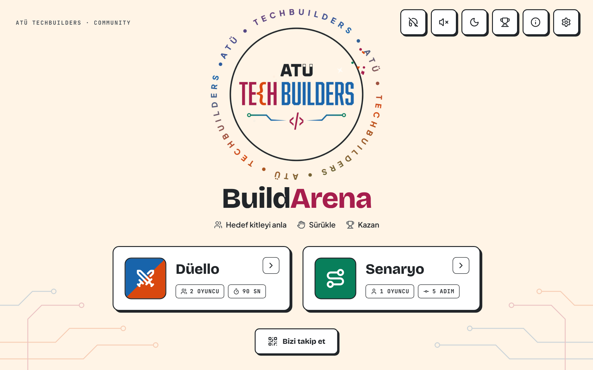
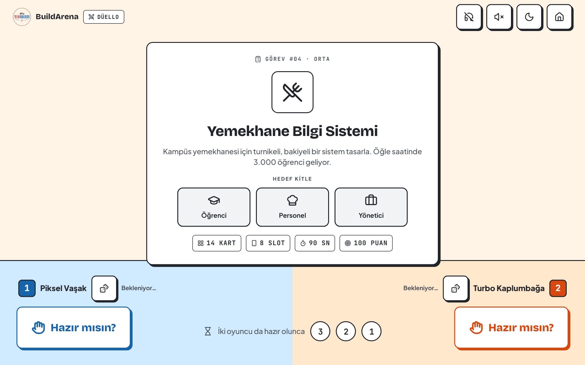
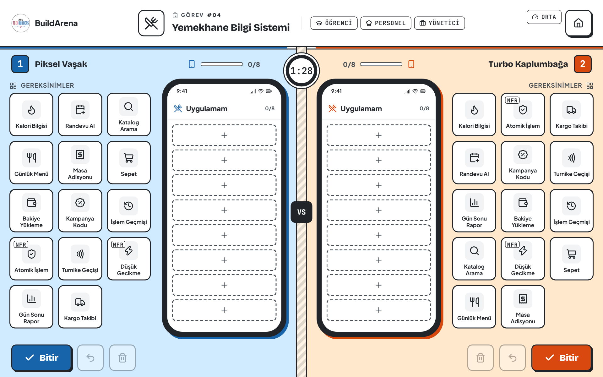
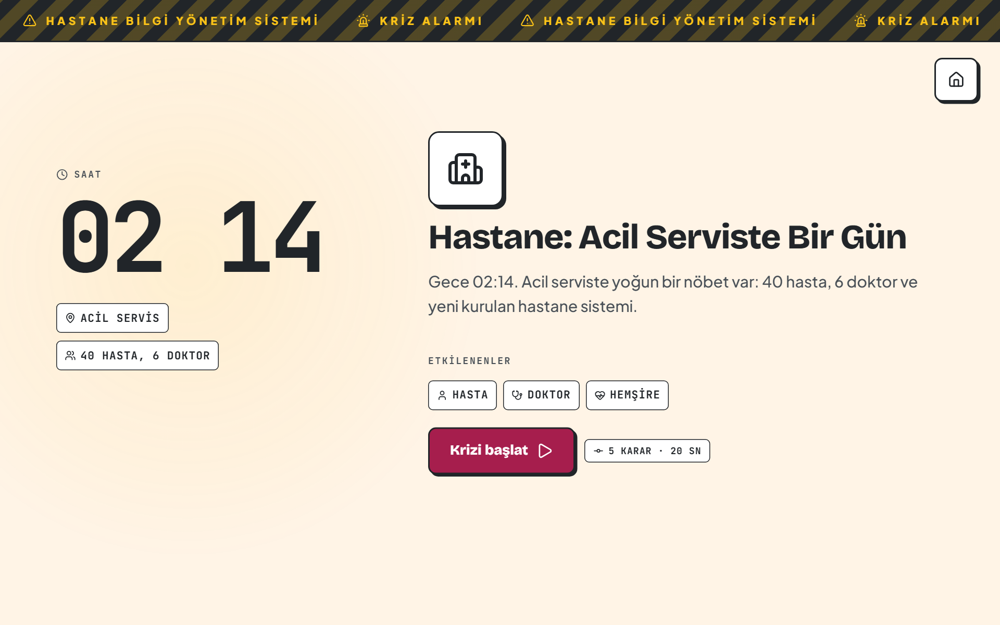
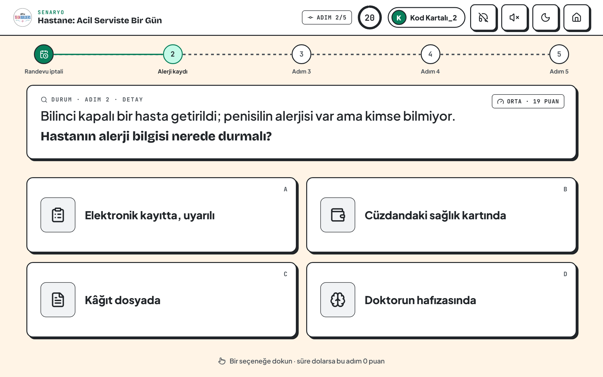
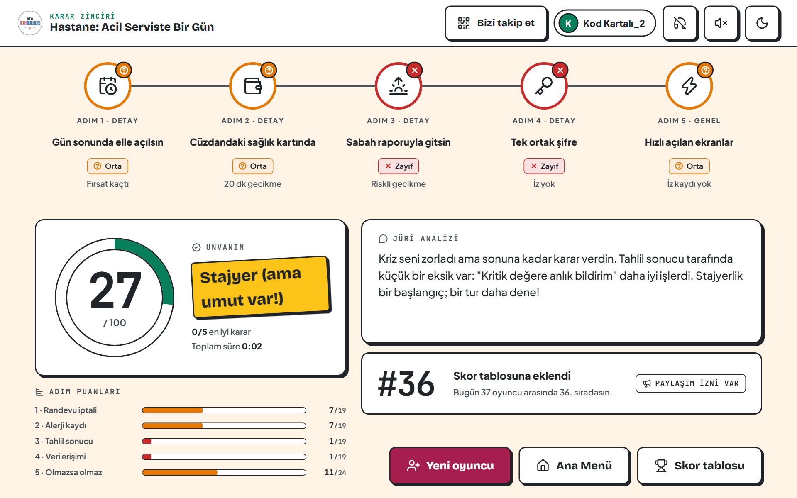
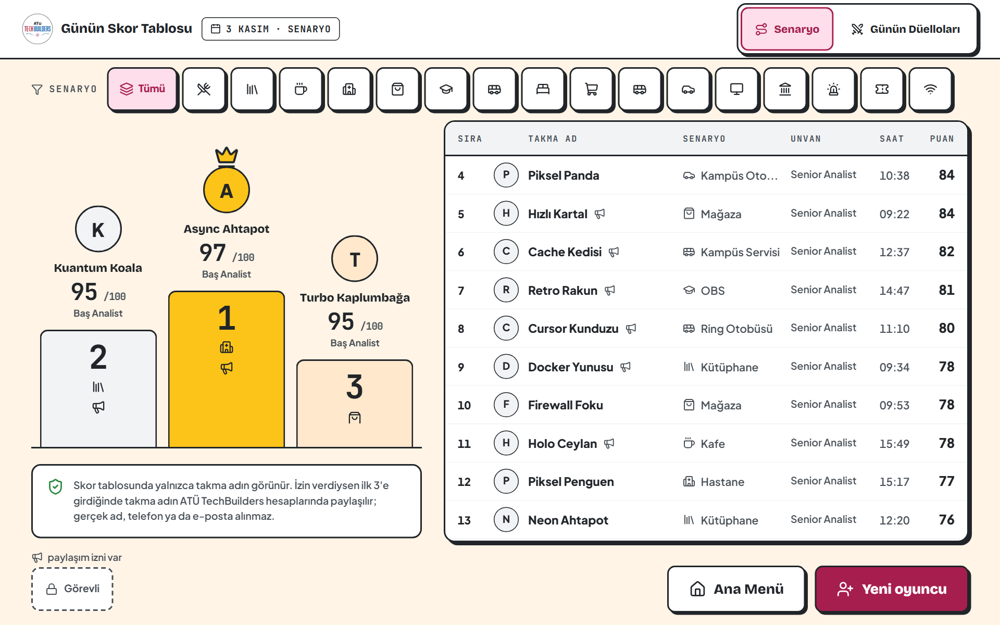
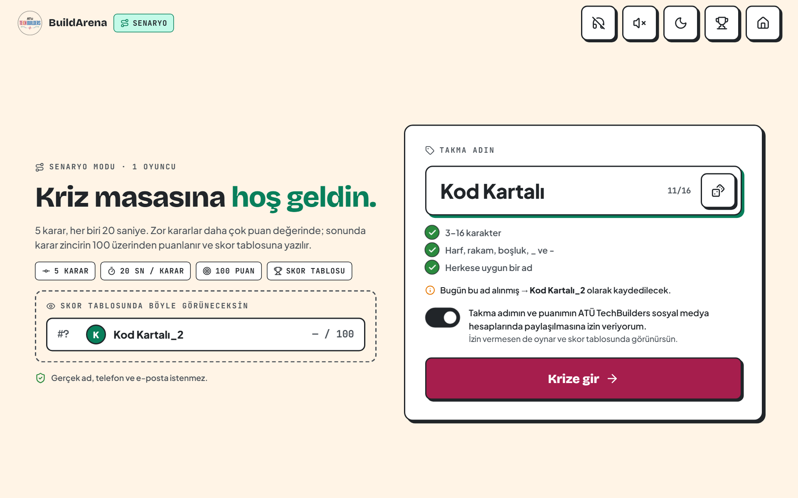
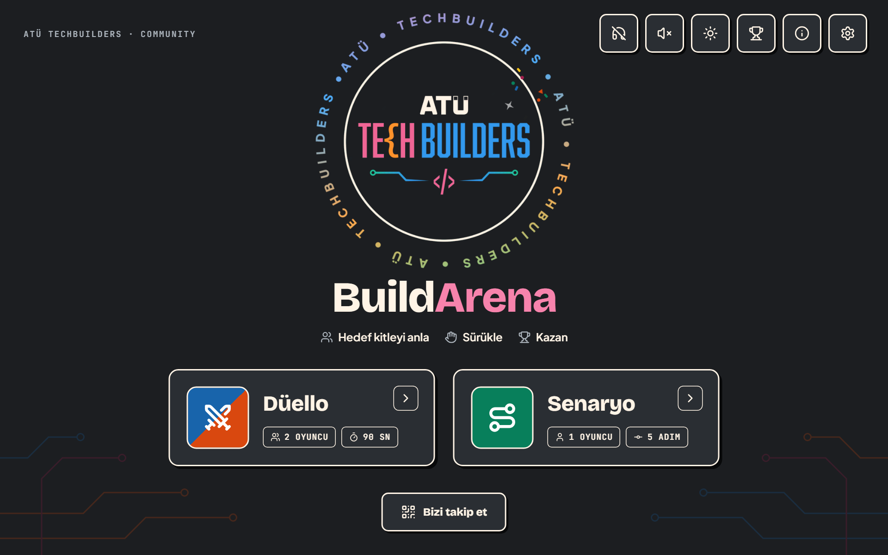

# BuildArena

[](https://github.com/TechBuildersATU/BuildArena/actions/workflows/ci.yml)


-lightgrey>)

**A requirements-analysis game for a university booth.** Two players race to build the right app
from requirement cards, or one player steers a campus system through a five-step crisis. Made by
**ATÜ TechBuilders** (Adana Alparslan Türkeş Science and Technology University) for its booth on
**4 November 2026**.

It runs full screen on a landscape tablet as an installable PWA or an Android APK, completely
offline. There is **no API and no AI**: tasks, scenarios, scoring, jury comments, funny titles and
the nickname filter are all local and deterministic, so a result can never be disputed. The game
speaks Turkish; the code and docs are in English. _(Türkçe oynanış rehberi en altta.)_



## Contents

- [Game modes](#game-modes)
- [Screenshots](#screenshots)
- [Features](#features)
- [Scoring](#scoring)
- [Nickname filter](#nickname-filter)
- [Getting started](#getting-started)
- [Android APK](#android-apk)
- [At the booth](#at-the-booth)
- [Project structure](#project-structure)
- [Tech stack](#tech-stack)
- [Testing](#testing)
- [Documentation](#documentation)
- [Contributing](#contributing)
- [License](#license)
- [Nasıl oynanır? (Türkçe)](#nasıl-oynanır)

## Game modes

### Duel — 2 players, 45 / 60 / 90 s

The tablet is split in two. Both players get the same task (for example a hospital information
system), its target audience and 14 requirement cards. Each player drags the cards that the
system really needs into their own phone box (8 slots) — and avoids the traps: a shopping cart in a
hospital app costs points. Both halves are fully isolated, so two people can drag at the same time
without touching each other's cards. A jury gives each player a funny epithet and a comment.
15 tasks, 84 cards.

### Scenario — 1 player, 5 decisions × 20 s

The player picks a nickname, a crisis wheel chooses one of 16 campus crises ("Cafeteria: 3,000
students at 11:58", "Emergency room at 02:14", "Black Friday at midnight" …) and the player makes five
decisions against the clock: four detailed requirement choices, then one about the whole system.
After every choice a butterfly-effect card shows what happened. The final draws the decision chain,
the score out of 100, a title from "Stajyer" (intern) to "Baş Analist" (lead analyst), a written jury
analysis and the player's place on today's leaderboard.

### Leaderboard and staff menu

Today's scenario podium and list (filter by crisis) and today's duels. A PIN-protected staff menu
exports the day's top 3 (only players who agreed to be shared) and an end-of-day summary as
Instagram post and story PNGs, changes round lengths, volume and the PIN, and archives the day.

## Screenshots

| Duel task card                                          | Duel                                                 |
| ------------------------------------------------------- | ---------------------------------------------------- |
|        |               |
| **Scenario: crisis intro**                              | **Scenario: decision step**                          |
|    |  |
| **Scenario: final**                                     | **Leaderboard**                                      |
|  |      |
| **Nickname**                                            | **Dark theme**                                       |
|      |         |

## Features

- **A board game on paper.** The club's "Renk Paleti": cream paper, ink lines, hard-shadow buttons
  that sink when pressed and four printed colours — blue player 1, orange player 2, teal scenario,
  raspberry for the one "play" button on a screen. A **dark theme** (the same palette at night) is
  one tap away in every header.
- **Made for a crowded booth.** 1280×800 stage scaled to any tablet, kiosk mode (no scrolling, zoom
  or text selection), ≥ 56 px touch targets, double-tap guards, idle mode with the day's top 3,
  a house button that asks before leaving a round, no rematch so the queue keeps moving.
- **Sound.** 35+ synthesised effects and generative music per part (chill lo-fi on the menus, a
  calm and mysterious piece in the scenario, a driving beat in the duel) — all Web Audio, no audio
  files. Separate music / effect buttons, a volume slider and short vibrations.
- **Offline first.** PWA with a service worker; scores live in IndexedDB and survive restarts; the
  share images are drawn on a canvas on the device.
- **Privacy.** Only nicknames, scores, titles, choices, times and a consent flag are stored — no real
  names, phone numbers or e-mail addresses. Nothing is ever posted automatically.
- **Security.** No secrets in the app (`npm run scan:bundle` guards the build); player text is
  rendered as text only; the staff PIN is never in the code: each tablet stores its own as a salted
  PBKDF2 hash (the public default 1234 must be changed before the event).
- **Accessibility.** Both themes are scanned with axe; status is never shown by colour alone;
  `prefers-reduced-motion` is respected.
- **Social.** "Bizi takip et" opens the club's Linktree QR code on the home screen and both results.
- **Android APK.** Capacitor wrapper with an animated launch screen, an opening animation, immersive
  full screen, keep-awake and a back button that never closes the game.

## Scoring

Every rule is a pure, unit-tested function in [`src/game/scoring.ts`](src/game/scoring.ts).

**Scenario (100 points).** Each step's maximum comes from its difficulty — a step with a tempting
runner-up option, and the final "general" step, are worth more — shared out to exactly 100. The
decision screen shows what a step is worth ("Zor karar · 21 puan"). Accuracy follows a convex curve,
`(points / 20)^1.5`: the best option gets the full step, a reasonable one (14/20) about 59 %, a weak
one (8/20) 25 %. 10 % of every step is a speed share: full in the first 2 s, falling to 0 at the
time limit, and multiplied by accuracy, so a fast wrong answer earns nothing extra. A step whose time
runs out scores 0, so **an empty game scores 0**. All best and fast = 100, all best at the last
second = 90.

| Score  | Title                   |
| ------ | ----------------------- |
| 90–100 | Baş Analist             |
| 75–89  | Senior Analist          |
| 55–74  | Mid Analist             |
| 35–54  | Junior Analist          |
| 0–34   | Stajyer (ama umut var!) |

**Duel (100 points).** Coverage 55 (critical cards weigh 3, important 2, support 1), accuracy 20
(F1 of precision and recall), combos 15 (pairs of cards that belong together), speed 10 (time left ×
design quality); −5 for every trap card, never below 0. **An empty box scores 0.** A tie goes to
fewer traps, then — if points were earned — to more time left; two empty boxes draw.

The leaderboard ranks by score, then shorter total time, then the earlier game.

## Nickname filter

Players type their own nickname at a public booth, so the local filter
([`src/game/profanity.ts`](src/game/profanity.ts), word lists in
[`src/data/badwords.json`](src/data/badwords.json)) is strict:

- **Every reading of a name is checked:** Turkish letters folded (ç ğ ı ö ş ü), digits and symbols
  read as letters (`S1kt1r`, `4mk`), `q`/`w` read as `k`/`v`, stretched letters squeezed
  (`siiiktir`, `naaamuuussuuuz`), letters split by dots, spaces or underscores joined (`s.i.k`),
  CamelCase split (`KralAmbiti`), words glued without a boundary (`kralsiktir`) and halves split by a
  space (`si ki`, `Amc ık`).
- **Strict roots:** every word starting with the most common vulgar roots (am, sik, göt, oç, piç,
  bok, seks …) is refused unless a real clean word covers it — Amca, Amerika, Sikke, Ocak, Götürü,
  Picasso, Seksen … Clean words are matched with their Turkish letters, so `Sıkılmış` and `Şık` pass
  while `sikilmiş` and `sik` don't.
- **Two clean words never make a bad one:** a hit split across words counts only where one side is
  not a whole clean word, so `Sıkı Savunma` and `Işık Erdem` are fine.
- Politics, terror and hate words, sexual words in Turkish and English, and `31` / `69` are refused
  too. Identity words (kürt, ermeni, gay …) are not insults and are not listed.

[`tests/unit/profanity.test.ts`](tests/unit/profanity.test.ts) tries 5,500+ disguises of 230 swears
plus 600+ glued spellings, and keeps the clean look-alikes usable. Offline it was also measured
against public Turkish blacklists (every real swear refused), 50,000 dictionary words and 50,000
frequent words (only real insults refused) and 300,000 random pairs of clean words and names (0.01 %
refused). If a name is refused, the dice in the field rolls one of ~3,700 generated "Tech Animal"
names.

## Getting started

Requires **Node.js 22+**.

```bash
git clone https://github.com/TechBuildersATU/BuildArena.git
cd BuildArena
npm install
npx playwright install chromium   # once, for the end-to-end tests
npm run dev                       # http://localhost:5173/?skipTutorial=1
```

| Command               | What it does                                                     |
| --------------------- | ---------------------------------------------------------------- |
| `npm run dev`         | Dev server: http://localhost:5173/?skipTutorial=1                |
| `npm test`            | Unit and component tests (Vitest)                                |
| `npm run e2e`         | End-to-end tests: 1280×800 touch tablet profile + offline PWA    |
| `npm run e2e:ui`      | The same in Playwright's UI                                      |
| `npm run lint`        | oxlint                                                           |
| `npm run typecheck`   | TypeScript                                                       |
| `npm run build`       | Production build + service worker                                |
| `npm run scan:bundle` | Fails if the build contains an API key pattern                   |
| `npm run check`       | All of the above in CI order — must be green before work is done |
| `npm run apk`         | Android test APK → `dist-apk/BuildArena-<version>-debug.apk`     |

Test-only URL flags (development builds): `?skipTutorial=1`, `?seed=N` (the wheel lands on crisis
N % 16; the duel task and names are fixed), `?fastTimers=1` (shorter animation waits), `?demo=1` (a
sample day in an empty database: 36 scenarios, 16 duels), `?intro=1` (plays the APK's opening
animation in the browser).

## Android APK

The web app is wrapped with Capacitor (`android/`, `capacitor.config.ts`). `npm run apk` builds it,
copies it into the Android project and makes a debug-signed APK with Gradle. Android Studio's SDK
and JDK 17–21 are found automatically (or set `ANDROID_HOME` / `JAVA_HOME`).

Inside the APK: landscape and immersive full screen (system bars show briefly on an edge swipe), the
screen never sleeps, vibration, the back button never closes the game, launcher icons from the logo,
and a two-step opening: the four palette colours draw a turning ring on the launch screen
(`res/drawable/splash_ring.xml`) until the game is ready (`MainActivity.java`, at most 8 s), then it
fades into the opening animation (`src/components/BootIntro.tsx`, tap to skip). The on-screen keyboard
opens over the game; the stage lifts only as far as needed to keep the field visible. Staff PNGs are
saved through Android's share sheet.

Install: copy the APK to the tablet (USB, Drive …), tap it and allow installs from unknown sources —
or `adb install -r dist-apk/BuildArena-0.1.0-debug.apk`. For a real kiosk, turn on Android's **app
pinning**.

## At the booth

1. **Change the staff PIN on every tablet:** hold the logo for 3 s (or the gear on the home screen) →
   PIN 1234 → Ayarlar → PIN'i değiştir. Write the new PIN down: it lives only on that tablet.
2. Set the round lengths and volume in the same menu; turn on app pinning.
3. At the end of the day: staff menu → İlk 3 → download the post and story PNGs; Gün sonu for the
   summary; then "Günü arşivle ve sıfırla" (nothing is deleted, the day moves to a dated archive).

Still to check by hand on the real tablet: two people dragging at once, music and volume at booth
noise, vibration, brightness of the paper theme under booth lights, scanning the Linktree QR from a
phone, smoothness of the opening animation. See [`docs/STATUS.md`](docs/STATUS.md).

## Project structure

```
src/app/         routing, first launch, test flags, storage, staff PIN, keyboard, Android glue
src/audio/       sound engine, effects, generative music, vibration
src/screens/     every screen (home, tutorial, duel, scenario, leaderboard, staff)
src/components/  shared parts (stage, dialogs, PIN pad, timers, sound buttons, icons)
src/game/        scoring, phone box, touch isolation, nickname + profanity filter, effects, share images
src/stores/      zustand stores (scenario, duel, settings, UI)
src/ai/          zod schemas of the data banks and the local jury templates (no API)
src/data/        84 cards, 15 duel tasks, 16 crises, tutorial, nicknames, filter word lists
src/db/          Dexie database (scores, duels, archives), legacy-record upgrade, sample day
src/styles/      design tokens and the CSS modules
tests/           unit and component tests (Vitest)
e2e/             Playwright tests (button matrix, multi-touch duel, scenario, staff, themes, offline)
android/         Capacitor Android project
store/           app store icons (App Store, Google Play, iOS, Android)
docs/            project document, scenario-mode document, full prototype, palette, screenshots
.agents/skills/  agent skills (work package, button tests, frontend design)
AGENTS.md        rules for coding agents (Claude Code, Antigravity)
```

## Tech stack

| Concern      | Choice                                                            |
| ------------ | ----------------------------------------------------------------- |
| App          | React 19, TypeScript 6, Vite 8                                    |
| Styling      | CSS Modules on design tokens; Tailwind 4 utilities available      |
| Routing      | react-router 7                                                    |
| State        | zustand                                                           |
| Validation   | zod 4 (every data bank is validated at start-up)                  |
| Storage      | Dexie 4 (IndexedDB)                                               |
| Icons        | lucide-react through an allow-list                                |
| Audio        | Web Audio API + Vibration API                                     |
| PWA          | vite-plugin-pwa                                                   |
| Android      | Capacitor 8                                                       |
| Fonts        | Bricolage Grotesque, Plus Jakarta Sans, JetBrains Mono (bundled)  |
| Tests        | Vitest, React Testing Library, fake-indexeddb, Playwright (+ axe) |
| Lint, format | oxlint, Prettier                                                  |
| Staff PIN    | @noble/hashes PBKDF2-SHA-256                                      |

## Testing

The club's rule: **every button and every page is tested while it is built.**

- **Unit and component tests** (Vitest): scoring, the duel box, touch isolation, the nickname rules
  and the profanity filter, the data banks, the database and its upgrade from older builds, the staff
  PIN, every screen's controls.
- **End-to-end tests** (Playwright, 1280×800 touch tablet): a button matrix (size ≥ 56 px, pressed
  feedback, double-tap guard, disabled state, touch and mouse), a full duel with real multi-touch CDP
  events, a full scenario, the staff menu, both themes scanned with axe, and an offline PWA run.
- **CI** runs `lint → typecheck → unit → build → secret scan → e2e` on every push and pull request.

## Documentation

| Document                                                                     | What it is                                                                               |
| ---------------------------------------------------------------------------- | ---------------------------------------------------------------------------------------- |
| [`AGENTS.md`](AGENTS.md)                                                     | The rules of the code base and the deviations the club agreed on                         |
| [`docs/PROJECT_DOCUMENT.md`](docs/PROJECT_DOCUMENT.md)                       | The planning document: product rules, flows, schemas, work packages, tests               |
| [`docs/scenario-mode/SCENARIO_MODE.md`](docs/scenario-mode/SCENARIO_MODE.md) | The scenario-mode design document and its playable prototype                             |
| [`docs/full-prototype/`](docs/full-prototype/)                               | The club's full prototype v0.3 (guide, playable app, screens) — every screen's reference |
| [`docs/palette/`](docs/palette/)                                             | The colour palette and component language ("Renk Paleti")                                |
| [`docs/STATUS.md`](docs/STATUS.md)                                           | What changed from the prototype and what still needs a check on the real tablet          |
| [`store/README.md`](store/README.md)                                         | App icons for the stores                                                                 |

The club's original Turkish documents are kept next to their English editions (`*_TR.pdf`,
`*_TR.docx`).

## Contributing

1. Read [`AGENTS.md`](AGENTS.md) and the skill in `.agents/skills/` that fits the task.
2. One topic per branch (`feature/short-name`), then a pull request; CI must be green.
3. UI text and game content are Turkish; code, identifiers, data keys and docs are English.
4. Every control you add gets its tests (see `.agents/skills/buildarena-button-tests/`), and
   `npm run check` must pass before you call the work done.

## License

The code is open source under the [MIT License](LICENSE). The ATÜ TechBuilders name and logo, the app
icons made from it and the club's documents in `docs/` are not covered by the license; all rights
reserved by ATÜ TechBuilders.

---

## Nasıl oynanır?

BuildArena, ATÜ TechBuilders standında oynanan bir **gereksinim analizi oyunudur**: bir uygulamanın
gerçekten neye ihtiyacı olduğunu bulursun. Ana ekranda iki mod var.

### Düello (2 kişi)

1. Ana ekranda **Düello**'ya dokunun. Görev kartı ikinize de aynı sistemi gösterir (ör. Hastane
   Bilgi Yönetim Sistemi) ve kimin için yapıldığını (hasta, doktor, hemşire) söyler.
2. Zar düğmesiyle adınızı değiştirebilirsiniz. İkiniz de **Hazır mısın?** düğmesine basınca 3-2-1 başlar.
3. Ekranın kendi yarınızda, sistemin **gerçekten ihtiyaç duyduğu** gereksinim kartlarını sürükleyip
   telefonunuzdaki 8 boş yuvaya bırakın. Aynı anda oynarsınız; kimse diğerinin kartına dokunamaz.
4. **Tuzaklara dikkat:** hastane uygulamasında "Sepet" gerekmez — her tuzak kart −5 puan. Yanlış
   koyduğunuz kartı geri alabilir ya da kutuyu temizleyebilirsiniz.
5. Bitirince **Bitir**'e basın; süre bitince oyun kendiliğinden biter. Erken ve doğru bitiren hız
   bonusu kazanır.
6. Sonuç ekranında puanınız (doğru seçim, isabet, birleşimler, hız, tuzak cezası), jürinin size
   taktığı lakap ve yorumu görünür. Kazananın üstünde taç vardır.

### Senaryo (1 kişi)

1. Ana ekranda **Senaryo**'ya dokun ve skor tablosunda görünecek bir **takma ad** yaz (3–16
   karakter; aklına gelmezse alandaki zara bas). İstersen adının kulübün sosyal medyasında
   paylaşılmasına izin ver.
2. **Kriz çarkı** kampüste bir kriz seçer (ör. "Yemekhane: Öğle Saati Krizi"). Kriz girişini oku ve
   **Krizi başlat**'a bas.
3. **5 karar** verirsin, her biri için **20 saniye**n var. Durumu oku, soruya en uygun seçeneğe dokun.
   İlk 4 adım ayrıntı (hangi özellik, hangi veri), 5. adım sistemin bütünü hakkındadır.
4. Her seçimden sonra **kelebek etkisi** kartı kararının ne yaptığını gösterir; dokununca geçer.
   Süre dolarsa o adım 0 puan alır.
5. Sonunda karar zincirin, **100 üzerinden puanın**, unvanın (Stajyer'den Baş Analist'e), jürinin
   yorumu ve **skor tablosundaki sıran** görünür. 75 puan üstünde konfeti!

### İpuçları

- Önce **hedef kitleyi** düşün: kimin işine yarıyor?
- Güvenlik, hız, çevrimdışı çalışma gibi **görünmeyen gereksinimler** (NFR) çoğu zaman en önemlileridir.
- Hızlı olmak puan kazandırır ama yalnızca doğru kararlarda.

Günün skor tablosu için ana ekrandaki **kupa** düğmesine dokun. Kulübü takip etmek için
**Bizi takip et** düğmesindeki QR kodu telefonunla okut.
