<div align="center">

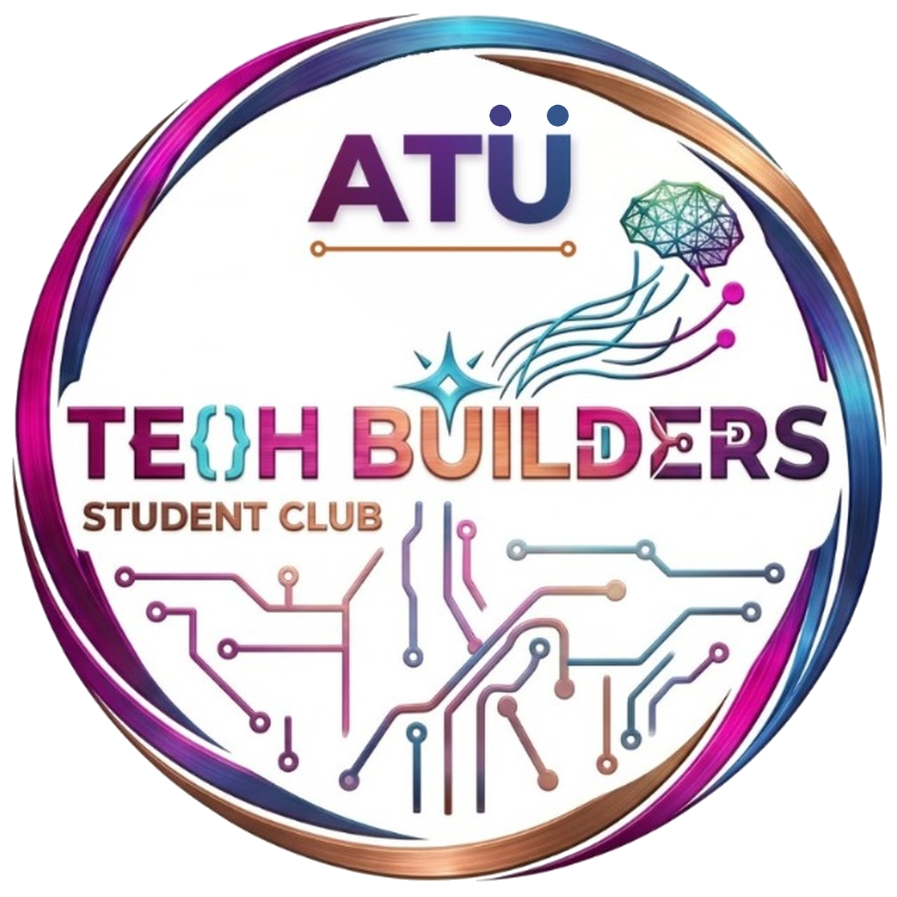

# BuildArena

### Gereksinim Düellosu ve Senaryo Oyunu

**ATÜ TechBuilders · 4 Kasım 2026 Stant Etkinliği**
Ürün, Oyun Tasarımı ve Teknik Mimari Dokümanı

</div>

| Sürüm | Tarih | Durum | Hazırlayan |
|---|---|---|---|
| 1.0 | 24 Ekim 2026 | İlk kapsamlı sürüm | ATÜ TechBuilders Yazılım Ekibi |
| 1.1 | 24 Ekim 2026 | İlk açılış tutorial'ı ve öncelik sıralı geliştirme planı eklendi | ATÜ TechBuilders Yazılım Ekibi |
| 1.2 | 24 Ekim 2026 | Kulübün v0.2 ekran tasarımları, logo dosyası ve renk paleti uygulandı | ATÜ TechBuilders Yazılım Ekibi |
| 1.3 | 25 Ekim 2026 | Kıvılcımlı dönen logo çerçevesi fikri kulüp kararıyla iptal edildi · Kulüp onayına hazır | ATÜ TechBuilders Yazılım Ekibi |

> **Not:** "BuildArena" çalışma adıdır; kulüp oylamasıyla değişebilir. Ekran görselleri (`assets/ekranlar/`) kulübün **v0.2 tasarımını** gösterir: sakin grafit tema, renkleri logodan türetilmiş palet (Bölüm 14). İngilizce sürüm (`BuildArena_Project_Document_EN.md`) ek olarak API güvenliği ve buton buton test planı bölümlerini içerir.

---

## İçindekiler

1. [Bir Bakışta](#1-bir-bakışta)
2. [Amaç, Hedef Kitle ve Tasarım İlkeleri](#2-amaç-hedef-kitle-ve-tasarım-ilkeleri)
3. [Uygulama Akışı](#3-uygulama-akışı)
4. [İlk Açılış Tutorial'ı (Slayt Bar)](#4-ilk-açılış-tutorialı-slayt-bar)
5. [Ana Ekran](#5-ana-ekran)
6. [Düello Modu (2 Oyuncu)](#6-düello-modu-2-oyuncu)
7. [Senaryo Modu (1 Oyuncu)](#7-senaryo-modu-1-oyuncu)
8. [Skor Tablosu ve Sosyal Medya Paylaşımı](#8-skor-tablosu-ve-sosyal-medya-paylaşımı)
9. [Gereksinim Kart Kataloğu (İkonlu)](#9-gereksinim-kart-kataloğu-ikonlu)
10. [Görev Bankası: 5 Sistem](#10-görev-bankası-5-sistem)
11. [Puanlama Sistemi (100 Puan)](#11-puanlama-sistemi-100-puan)
12. [Yapay Zekâ Entegrasyonu (NVIDIA NIM)](#12-yapay-zekâ-entegrasyonu-nvidia-nim)
13. [Teknik Mimari](#13-teknik-mimari)
14. [Tasarım Sistemi](#14-tasarım-sistemi)
15. [Claude Code ve Skill'lerle Geliştirme](#15-claude-code-ve-skilllerle-geliştirme)
16. [Geliştirme Planı: Öncelik Sıralı İş Paketleri](#16-geliştirme-planı-öncelik-sıralı-iş-paketleri)
17. [Yol Haritası (25 Ekim – 4 Kasım)](#17-yol-haritası-25-ekim--4-kasım)
18. [Riskler ve Önlemler](#18-riskler-ve-önlemler)
19. [Açık Sorular](#19-açık-sorular)

---

## 1. Bir Bakışta

BuildArena, **yazılım gereksinim analizini** stantta 2 dakikada oynanabilen bir oyuna dönüştürür. Temel fikir tek cümledir:

> **"Her özellik iyi değildir; doğru kullanıcıya doğru özellik."**

Hastane uygulamasında **Sepet** butonu, mağaza uygulamasında **Randevu Al** butonu gereksizdir. Oyuncu bunu fark ettiği ölçüde puan kazanır.

| Başlık | Karar |
|---|---|
| Kulüp | ATÜ TechBuilders |
| Etkinlik | 4 Kasım 2026 · Stant |
| Platform | Tablet / dokunmatik ekran, yatay, tam ekran web uygulaması (PWA) |
| İlk açılış | 5 slaytlık tutorial: üstte slayt bar, Atla / Geri / İleri, kaydırma jesti |
| Modlar | **Düello** — 2 oyuncu, aynı ekranda, sürükle-bırak<br>**Senaryo** — 1 oyuncu, çoktan seçmeli karar zinciri |
| Tur süresi | Düello: 90 sn · Senaryo: adım başına 20 sn (5 adım) |
| Puanlama | 100 üzerinden, yapay zekâ destekli |
| Takma adlar | Düello: yapay zekâ eğlenceli takma ad üretir · Senaryo: oyuncu kendisi yazar |
| Skor tablosu | Senaryo modu; günün ilk 3'ü kulübün sosyal medya hesaplarında paylaşılır |
| Önyüz | React + TypeScript + Vite (Bölüm 13.1) |
| Yapay zekâ | NVIDIA NIM (build.nvidia.com) ücretsiz API, OpenAI uyumlu uç nokta |
| Gereksinim kaynağı | Kütüphane, Yemekhane, Kafe, Hastane (HBYS), Mağaza sistemleri |
| Geliştirme planı | 17 iş paketi, 4 öncelik seviyesi, 4 kilometre taşı (Bölüm 16) |

---

## 2. Amaç, Hedef Kitle ve Tasarım İlkeleri

### 2.1 Neden bu oyun?

- **Kulübü tanıtır:** ATÜ TechBuilders'ın "yazılım üretiriz, kampüse ürün ve AR-GE ile katkı sağlarız" mesajını somut bir ürünle gösterir.
- **Ders konusunu eğlenceye çevirir:** Software Requirements dersindeki fonksiyonel / fonksiyonel olmayan gereksinim, aktör ve hedef kitle kavramlarını yazılım bilmeyen birinin bile anlayacağı hale getirir.
- **Stantta kalabalık çeker:** İki kişilik kapışma izlemesi de eğlenceli bir şovdur; skor tablosu insanları tekrar getirir.

### 2.2 Kimler oynayacak?

| Grup | Beklenti |
|---|---|
| Oyuncular | Üniversite öğrencileri, lise ziyaretçileri, akademisyenler. Yazılım bilgisi gerekmez. |
| İzleyiciler | Sırada bekleyenler ve stantın önünden geçenler. Ekranın iki yarısı yan yana olduğu için kimin önde olduğu uzaktan anlaşılır. |
| Görevliler | Kulüp üyeleri. Oyunu başlatır, gerekirse duraklatır, skor tablosunu yönetir ve ilk 3'ü dışa aktarır. |

### 2.3 Tasarım ilkeleri

| İlke | Anlamı |
|---|---|
| 10 saniyede anlaşılır | Görev üstte, kartlar yanda, kutu ortada. Açıklama metni yok. |
| Az yazı, çok ikon | Her kart = 1 ikon + en fazla 2 kelime. |
| Adil yarış | İki oyuncu aynı görevi, aynı kartları, aynı süreyi alır; kart sırası ayrı karıştırılır (kopya zorlaşır). |
| Müdahale yok | Her oyuncu yalnızca kendi yarısına dokunabilir (Bölüm 13.5). |
| Heyecan sonda | Oyun sırasında doğru/yanlış gösterilmez; sonuç ekranında birlikte açılır. |
| Hızlı tur | Görevden sonuca ~2 dakika; stant kuyruğu akar. |
| İnternetsiz de çalışır | Yapay zekâ yanıt vermezse hazır görev bankası devreye girer; oyuncu farkı hissetmez. |

---

## 3. Uygulama Akışı

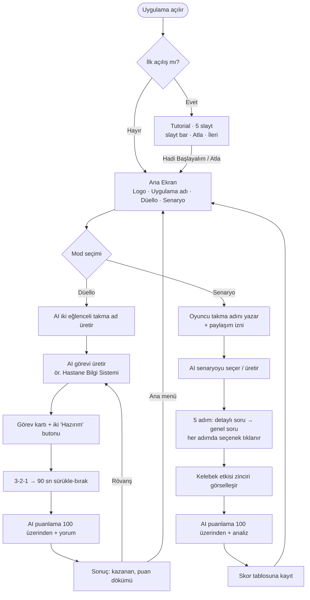

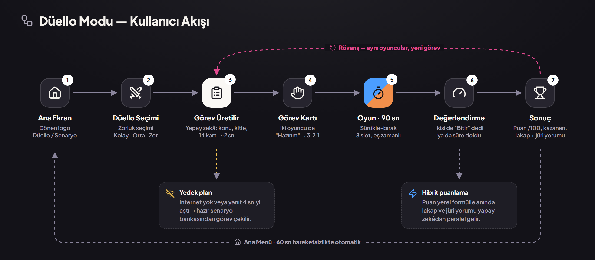
*Kulübün v0.2 tasarımından Düello akışı: Ana Ekran → Düello seçimi → görev üretimi → görev kartı → 90 sn oyun → değerlendirme → sonuç; rövanş, yedek plan ve hibrit puanlama notlarıyla.*

---

## 4. İlk Açılış Tutorial'ı (Slayt Bar)

Uygulama ilk açıldığında, ana ekrandan önce **5 slaytlık kısa bir tanıtım** gösterilir. Amaç, stanta gelen birinin **30 saniyede** oyunun mantığını, iki modu ve puanlamayı kavramasıdır. Tutorial ekranı v0.2 tasarım sistemine uyar: sakin grafit zemin, düz yüzeyler, vurgu için logo pembesi (Bölüm 14.2).

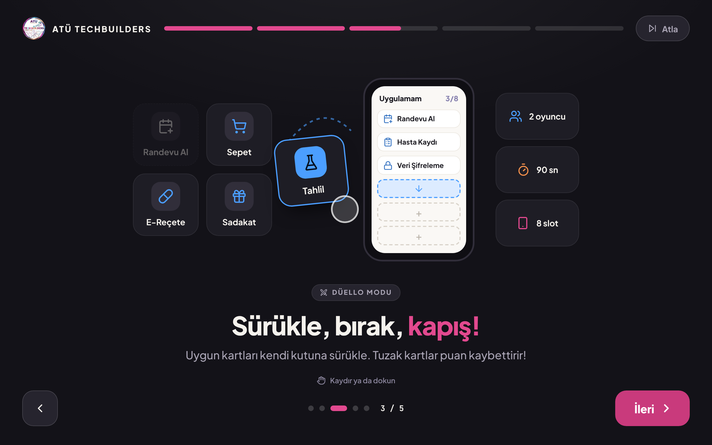
*Tutorial'ın 3. slaytı: üstte segmentli slayt bar ve Atla butonu, ortada animasyonlu anlatım, altta Geri / ilerleme noktaları / İleri.*

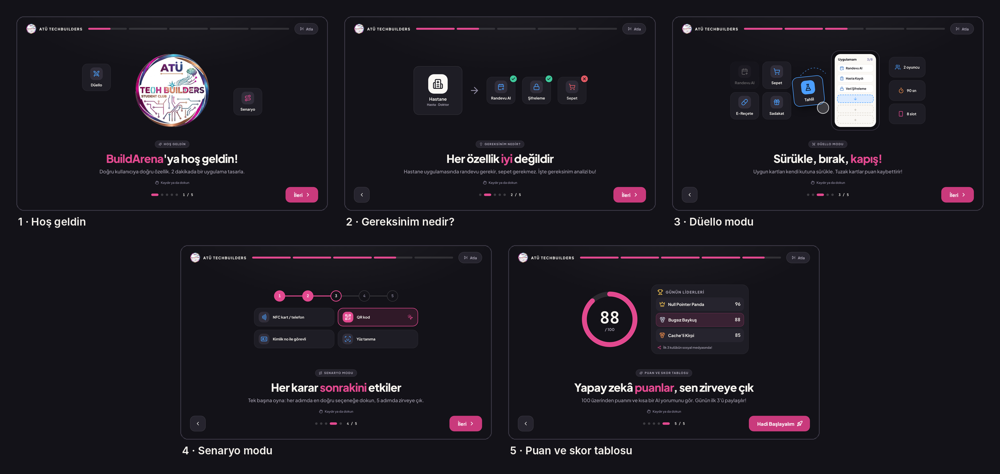
*Beş slaytın genel görünümü: Hoş geldin → Gereksinim nedir? → Düello → Senaryo → Puan ve skor tablosu.*

### 4.1 Ne zaman gösterilir?

| Durum | Davranış |
|---|---|
| İlk açılış | Uygulama cihazda ilk kez açıldığında otomatik gösterilir (`buildarena.tutorialSeen` kaydı yoksa). "Hadi Başlayalım" ya da "Atla" ile kayıt oluşur ve ana ekrana geçilir. |
| Nasıl Oynanır butonu | Ana ekrandaki bilgi (i) butonu tutorial'ı her zaman yeniden açar. |
| Bekleme modu (ayar) | Ayarlarda "Bekleme modunda tutorial döngüsü" açıksa, 60 sn dokunulmadığında slaytlar otomatik ve sessizce döner; ekrana dokunulunca ana ekrana dönülür. Stantın önünden geçenler oyunu ekranda öğrenir. |
| Görevli menüsü | "Tutorial'ı sıfırla" ile bir sonraki açılışta yeniden gösterilir (test ve kurulum için). |

### 4.2 Slaytlar

| # | Başlık | Alt metin | Görsel / animasyon | Süre |
|---|---|---|---|---|
| 1 | **BuildArena'ya hoş geldin!** | Doğru kullanıcıya doğru özellik. 2 dakikada bir uygulama tasarla. | Kulüp logosu ve çevresinde dönen "ATÜ • TECHBUILDERS" yazısı; Düello ve Senaryo kartları iki yanda süzülür | 5 sn |
| 2 | **Her özellik iyi değildir** | Hastane uygulamasında randevu gerekir, sepet gerekmez. İşte gereksinim analizi bu! | Hastane görev kartı → Randevu Al ✓, Şifreleme ✓, Sepet ✗ işaretleri sırayla belirir | 6 sn |
| 3 | **Sürükle, bırak, kapış!** | Uygun kartları kendi kutuna sürükle. Tuzak kartlar puan kaybettirir! | Parmak animasyonu bir kartı havuzdan telefona taşır; "2 oyuncu · 90 sn · 8 slot" çipleri | 7 sn |
| 4 | **Her karar sonrakini etkiler** | Tek başına oyna: her adımda en doğru seçeneğe dokun, 5 adımda zirveye çık. | 5 adımlık karar zinciri dolar; 4 seçenekten biri tıklanıp vurgulanır | 7 sn |
| 5 | **Yapay zekâ puanlar, sen zirveye çık** | 100 üzerinden puanını ve kısa bir AI yorumunu gör. Günün ilk 3'ü paylaşılır! | Puan halkası 0'dan dolar; "Günün Liderleri" satırları kayarak gelir. Buton: **Hadi Başlayalım** | 6 sn |

Toplam izleme süresi otomatik ilerlemeyle ~31 saniyedir; oyuncu istediği an "Atla" ile geçebilir. Metinler kısa tutulur: başlık en fazla 6, alt metin en fazla 14 kelime.

### 4.3 Slayt bar ve kontroller

| Öğe | Davranış |
|---|---|
| Slayt bar (üst) | 5 segmentli ilerleme çubuğu. Geçilen slaytlar dolu, aktif slayt süresi boyunca logo pembesiyle dolar (hikâye tarzı). Bir segmente dokunmak o slayta atlar. |
| Atla (sağ üst) | Tutorial'ı kapatır, ana ekrana geçer. |
| Geri / İleri (alt) | Büyük butonlar (en az 64 px). İlk slaytta Geri gizlidir; son slaytta İleri yerine **Hadi Başlayalım** çıkar. |
| İlerleme noktaları | Alt ortada 5 nokta + "3 / 5" sayacı; aktif nokta uzar. |
| Kaydırma | Sola kaydır → sonraki, sağa kaydır → önceki slayt. |
| Basılı tutma | Ekrana basılı tutulduğu sürece otomatik ilerleme durur (okumak isteyen için). |
| Otomatik ilerleme | Her slayt kendi süresi kadar gösterilir. Oyuncu bir kontrole dokunursa o slaytın sayacı sıfırlanır. |
| Hareket azaltma | Cihazda "hareketi azalt" açıksa (`prefers-reduced-motion`) animasyonlar ve otomatik ilerleme kapanır; slaytlar elle geçilir. |

### 4.4 Teknik notlar

- Bileşen: `src/screens/Onboarding.tsx`. Slayt metinleri ve süreleri `src/data/tutorial.json` dosyasındadır; kod değiştirmeden düzenlenebilir.
- Slayt görselleri statik resim değil, oyunun gerçek bileşenleriyle (Card, PhoneBox, ScoreRing) çizilir. Böylece tasarım değişince tutorial da kendiliğinden güncel kalır ve internet gerektirmez.
- Geçişler Framer Motion `AnimatePresence` ile (kayma + solma, ~320 ms); kaydırma `drag="x"` ile algılanır.
- `localStorage` okuma/yazma `try/catch` içindedir; kayıt okunamazsa tutorial gösterilir (güvenli varsayılan).
- Referans HTML: `assets/tasarim_kaynak/09_tutorial.html` (`?s=1` … `?s=5`).

---

## 5. Ana Ekran

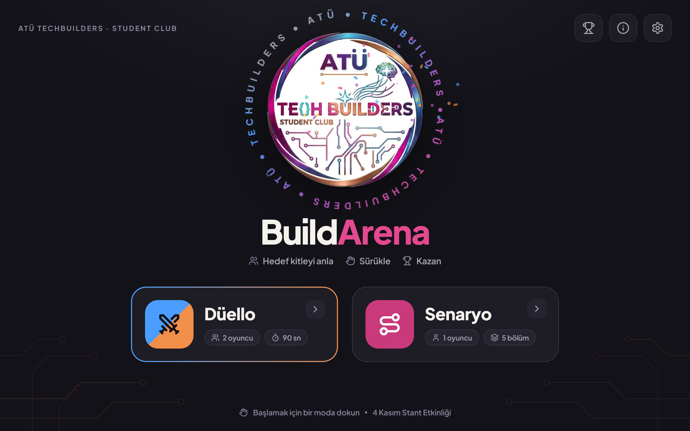
*Ana ekran (v0.2): üst-ortada kulüp logosu ve çevresinde dönen "ATÜ • TECHBUILDERS" yazısı, Düello ve Senaryo butonları, sağ üstte Skor Tablosu / Bilgi / Ayarlar.*

| Öğe | İçerik |
|---|---|
| Logo | ATÜ TechBuilders logosu üst-ortada (küçük hali tüm ekranların sol üstünde). Çevresinde "ATÜ • TECHBUILDERS" yazısı 26 saniyede bir tur döner; yazının rengi logodaki pembe → mor → mavi → bakır geçişini izler. Logodaki parıltılı noktalardan (yıldız, dokunaç uçları, beyin) yaklaşık 1,2 saniyede bir mini konfeti çıkar. Logonun kendisi değiştirilmez. |
| Uygulama adı | **Build** krem beyaz + **Arena** logo pembesi; altında üç ikonlu slogan: *Hedef kitleyi anla · Sürükle · Kazan* |
| Kulüp adı | Sol üstte "ATÜ TECHBUILDERS" yazısı |
| Mod butonları | **Düello** (2 oyuncu · 90 sn · AI) ve **Senaryo** (1 oyuncu · 5 adım · AI) — iki büyük kart |
| Sağ üst | Skor Tablosu (kupa), Nasıl Oynanır (bilgi; tutorial'ı yeniden açar), Ayarlar (dişli; görevli PIN'i ister) |
| Bekleme modu | 60 sn dokunulmazsa logo büyür, konfeti sıklaşır, "Dokun ve oyna" yazısı ve günün ilk 3'ü döner; ayar açıksa tutorial slaytları döngüde oynar (stantın önünden geçenleri çeker). |

---

## 6. Düello Modu (2 Oyuncu)

### 6.1 Oyunun özü

1. Yapay zekâ bir **görev** verir. Örnek: *"Bir hastane bilgi yönetim sistemi tasarla. Hedef kitle: hasta, doktor, hemşire."*
2. Her oyuncunun tarafında aynı **gereksinim havuzu** (14 ikonlu kart) vardır. Bunların 8'i hedef kitleye uygundur, 6'sı **tuzaktır** (başka uygulamaya ait).
3. Oyuncular süre bitmeden uygun gördükleri gereksinimleri **kendi kutularına** (telefon çerçevesi) sürükleyip bırakır.
4. Yapay zekâ iki tasarımı 100 üzerinden puanlar ve kimin gereksinim analizinin daha doğru, hedef kitleye daha uygun olduğunu açıklar.

### 6.2 Ekran yerleşimi

Kullanıcının tarif ettiği yerleşim: **Oyuncu 1 solda** (gereksinim havuzu + yanında kendi kutusu), **Oyuncu 2 sağda** (tam simetriği). **Üst panelde** görevin adı ve kronometre.

```
┌──────────────────────────────────────────────────────────────────────────────┐
│ [logo] GÖREV #07 · Hastane Bilgi Yönetim Sistemi   [Hasta][Doktor][Hemşire]  ⏱ 0:54 │  ← üst panel (ortak, dokunmaya kapalı)
├───────────────────────────────────────┬──────────────────────────────────────┤
│ (1) Turbo Kaplumbağa        5/8       │       4/8     Bugsız Baykuş (2)      │  ← AI takma adları
│ ┌──────────────┐  ┌───────────────┐   │   ┌───────────────┐  ┌──────────────┐ │
│ │ GEREKSİNİM   │  │  UYGULAMAM    │   │   │  UYGULAMAM    │  │ GEREKSİNİM   │ │
│ │ HAVUZU       │  │ ┌───────────┐ │   │   │ ┌───────────┐ │  │ HAVUZU       │ │
│ │ [📅][🛒][💊] │→ │ │📅 Randevu │ │ VS│   │ │🛒 Sepet    │ │ ←│ [🛒][📅][🔒] │ │
│ │ [🔒][🧪][🎁] │  │ │🔒 Şifreleme│ │   │   │ │📅 Randevu │ │  │ [🧪][💊][🎁] │ │
│ │ [ … 14 kart ]│  │ │  + boş    │ │   │   │ │  + boş    │ │  │ [ … 14 kart ]│ │
│ └──────────────┘  └───────────────┘   │   └───────────────┘  └──────────────┘ │
│ [✓ Bitir] [↶] [🗑]                     │                     [🗑] [↶] [✓ Bitir] │  ← eylem çubuğu (dış köşe)
└───────────────────────────────────────┴──────────────────────────────────────┘
          OYUNCU 1 BÖLGESİ          24 px ölü bölge          OYUNCU 2 BÖLGESİ
```

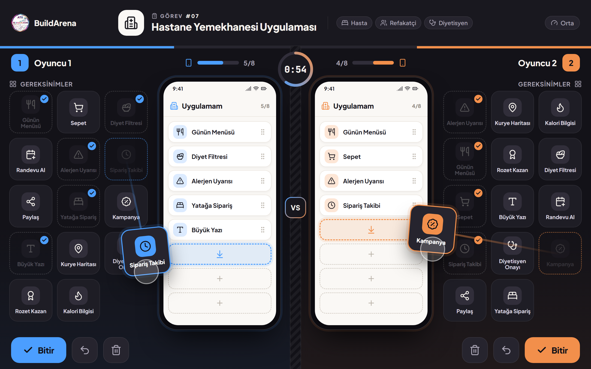
*Düello ekranı (v0.2): havuzlar dış kenarda, kutular (telefon çerçeveleri) ortada yan yana; Oyuncu 1 mavi, Oyuncu 2 bakır. İzleyiciler iki tasarımı yan yana karşılaştırabilir.*

| Bölge | İçerik |
|---|---|
| Üst panel | Kulüp logosu, sade "GÖREV #07" etiketi, görev adı, hedef kitle çipleri, zorluk, **kronometre** (geri sayım, mavi → bakır). Son 10 sn kırmızı ve nabız gibi atar. |
| Oyuncu başlığı | Numara rozeti (1/2), **AI takma adı**, doluluk göstergesi (ör. 5/8), oyuncu renginde süre çubuğu. |
| Gereksinim havuzu | 14 kart, 3 sütun. Her kart: Lucide ikonu + en fazla 2 kelime + küçük "NFR" rozeti (fonksiyonel olmayan gereksinimse). Kullanılan kartın yerinde kesikli gölge kalır. |
| Oyuncu kutusu | 8 slotlu telefon çerçevesi. Bırakılan kart gerçek bir uygulama satırına dönüşür. Kutudan dışarı sürüklenen kart havuza döner. |
| Eylem çubuğu | **Bitir** (0,6 sn basılı tut), **Geri al**, **Temizle**. |

### 6.3 Kurallar

| Kural | Değer |
|---|---|
| Kart havuzu | 14 kart: 8 gerekli (3 kritik + 4 önemli + 1 destekleyici) + 6 tuzak |
| Kutu kapasitesi | 8 slot — oyuncu seçim yapmak zorunda |
| Süre | 90 sn (Kolay: 120 sn · Zor: 60 sn ve 16 kart) |
| Erken bitirme | "Bitir"e basılı tutan oyuncunun tarafı kilitlenir, kalan süresi kaydedilir; diğeri devam eder |
| Eşitlik | Önce daha az tuzak kart, sonra daha çok kalan süre kazanır; yine eşitse berabere |
| Geri bildirim | Oyun sırasında doğru/yanlış gösterilmez |
| Hareketsizlik | Sonuç ekranında 60 sn dokunulmazsa ana ekrana dönülür |

### 6.4 Yapay zekâ takma adları

Düello başlarken yapay zekâ iki oyuncuya rastgele, eğlenceli ("makara") takma adlar verir. Takma adlar başlıkta, sonuç ekranında ve rövanşta görünür. Oyuncu beğenmezse adının yanındaki zar ikonuna bir kez dokunarak yeni ad isteyebilir.

| Kural | Açıklama |
|---|---|
| Ton | Yazılım/teknoloji esprili, sevimli, kimseyi aşağılamayan |
| Biçim | 2–3 kelime, en fazla 20 karakter, Türkçe |
| Yasak | Küfür, hakaret, dış görünüş, din, siyaset, cinsiyet, gerçek kişi ve marka adı |
| Çeşitlilik | Son 50 ad hafızada tutulur, tekrar edilmez |
| Yedek | AI 2 sn içinde yanıt vermezse yerel listeden seçilir |

**Örnek takma adlar (yedek liste için başlangıç):** Bugsız Baykuş · Turbo Kaplumbağa · Gereksinim Ninjası · Sepetsiz Samuray · Null Pointer Panda · Kahvesiz Geliştirici · Sonsuz Döngü Sincabı · Commit Canavarı · 404 Kedisi · Deploy Dervişi · Merge Conflict Maymunu · Stack Overflow Kartalı · Pixel Penguen · Refactor Rakunu · Cache'li Kirpi · Async Ahtapot · Lag'siz Leopar · Semicolon Sülün · Debug Dedektifi · Spagetti Kod Şefi

### 6.5 Görev kartı ve sonuç ekranı

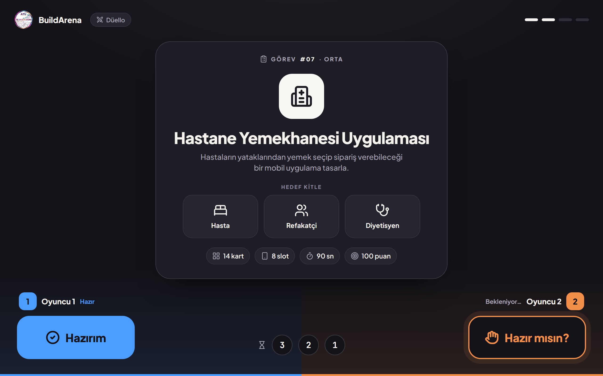
*Görev kartı (v0.2): sade "GÖREV #07 · ORTA" etiketi, görev, hedef kitle ve kurallar; her oyuncu kendi köşesindeki "Hazırım"a basınca 3-2-1 geri sayımı başlar.*

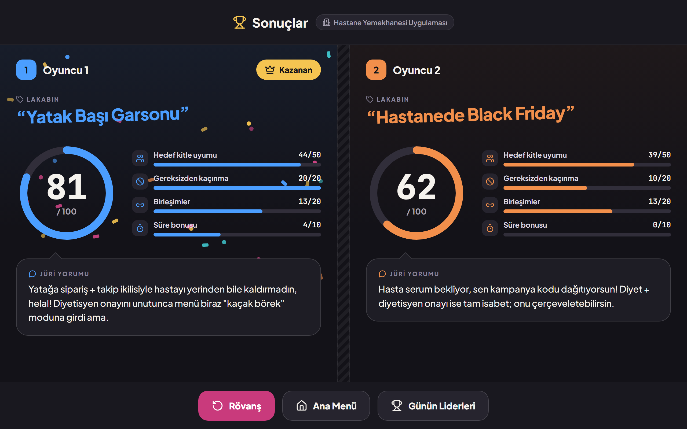
*Sonuç ekranı (v0.2): her oyuncu kendi yarısında 100 üzerinden puan halkasını, 4 bileşenli dökümü, yapay zekânın verdiği komik lakabı ve jüri yorumunu görür.*

Sonuç ekranı puan halkasını ve 4 bileşenli dökümü korur, sade kalır (v0.2'de kart listesi ve birleşim çipleri kaldırıldı):

- **Lakap:** yapay zekâ her oyuncuya o turdaki seçimlerine göre 2–4 kelimelik komik bir lakap verir. Ör. yatağa sipariş ve takip ikilisini kuran oyuncuya *"Yatak Başı Garsonu"*, Sepet ve Kampanya ekleyen oyuncuya *"Hastanede Black Friday"*. Lakap ekrana "damga" gibi basılır.
- **Jüri yorumu:** her oyuncuya en fazla 2 esprili cümle — bir övgü + bir takılma — daktilo efektiyle yazılır.
- **Açılış sırası:** puan halkası dolar ve sayı sayarak artar (0–1,4 sn) → döküm çubukları dolar → lakap damgalanır (1,55 sn) → kazanana taç düşer → logo renklerinde konfeti (1,7–5 sn) → jüri yorumu yazılır (2,1 sn →).
- Alt bar: **Rövanş** (yeni görev), **Ana Menü**, **Günün Liderleri**.

Kart kart analiz (✓ doğru · ✗ tuzak · ! kaçırılan) yine hesaplanır ve tur kaydıyla birlikte görevliler ve testler için saklanır; ancak bu ekranda gösterilmez.

---

## 7. Senaryo Modu (1 Oyuncu)

### 7.1 Oyunun özü

Senaryo modunda oyuncu tek başına oynar. Kutu ve sürükle-bırak yoktur; bunun yerine her adımda **birden fazla seçenek** sunulur ve oyuncu en doğru bulduğuna **tıklar**. Oyun, "Kelebek Etkisi" fikrinden ilham alır: her karar bir sonraki durumu etkiler ve sonunda kararların zincirleme etkisi görselleştirilir.

Fark şu: genel kültür ya da genel soru yerine **detaylı gereksinim kararlarından genele** ulaşılır. İlk adımlar somut bir özelliği sorar (hangi giriş yöntemi, hangi ekran, hangi veri); son adım sistemin bütününe dair genel bir karardır (en kritik fonksiyonel olmayan gereksinim nedir, öncelik ne olmalı).

| Başlık | Karar |
|---|---|
| Oyuncu | 1 kişi; girişte takma ad yazar |
| Uzunluk | 5 adım × 20 sn ≈ 2 dakika |
| Adım yapısı | Kısa durum metni + 4 seçenek (ikonlu kartlar). Tıklanan seçenek kilitlenir. |
| Sıra | Adım 1–4 detaylı (özellik/veri/akış), Adım 5 genel (mimari / fonksiyonel olmayan gereksinim / öncelik) |
| Kelebek etkisi | Her seçimden sonra 1,5 sn'lik "sonuç" kartı: seçimin kısa vadeli etkisi (doğru/yanlış söylenmez) |
| Final | Kararlar zinciri görselleşir + AI 100 üzerinden puanlar + kısa analiz yazar → skor tablosuna işlenir |

### 7.2 Takma ad girişi

- Oyuncu senaryoya girmeden **takma adını yazar** (3–16 karakter; harf, rakam, boşluk, `_` ve `-`).
- Küfür/hakaret filtresinden geçer (yerel Türkçe/İngilizce kelime listesi + AI kontrolü). Uygunsuz adlar reddedilir: *"Bu ad kullanılamıyor, başka bir ad dene."*
- Aynı ad bugün zaten varsa sonuna sayı eklenir (ör. `Korsan_2`).
- Ad alanının altında onay kutusu: **"Takma adımın ve puanımın ATÜ TechBuilders sosyal medya hesaplarında paylaşılmasına izin veriyorum."** İşaretlenmezse oyuncu yine oynar ve skor tablosunda görünür, ancak sosyal medya paylaşımına dahil edilmez (Bölüm 8.3).
- Gerçek ad, numara, e-posta istenmez.

### 7.3 Ekran yerleşimi

```
┌──────────────────────────────────────────────────────────────────────────┐
│ [logo] SENARYO · Yemekhane: Öğle Saati Krizi     Adım 2/5   ⏱ 0:14   🦉 Korkut │
├──────────────────────────────────────────────────────────────────────────┤
│  ●━━━━●━━━━○━━━━○━━━━○      ← karar zinciri (tamamlanan adımlar dolu)      │
│                                                                          │
│  DURUM                                                                   │
│  Öğrenci turnikeden geçti ama bakiye düşümü 2 sn gecikti.                │
│  Bakiye ve geçiş izni nasıl işlenmeli?                                   │
│                                                                          │
│  ┌──────────────────────┐  ┌──────────────────────┐                     │
│  │ 🚪 Önce kapı açılsın, │  │ 🛡 Bakiye düşümü ve   │                     │
│  │    bakiye sonra düşsün│  │    geçiş tek işlemde │                     │
│  └──────────────────────┘  └──────────────────────┘                     │
│  ┌──────────────────────┐  ┌──────────────────────┐                     │
│  │ 🌙 Gün sonunda toplu  │  │ 🚫 Bakiye kontrolü    │                     │
│  │    düşülsün          │  │    kaldırılsın       │                     │
│  └──────────────────────┘  └──────────────────────┘                     │
└──────────────────────────────────────────────────────────────────────────┘
```

### 7.4 Örnek senaryo: "Yemekhane: Öğle Saati Krizi"

Kaynak: Yemekhane Bilgi Sistemi gereksinimleri. Her seçeneğin puanı (0–20) yapay zekânın ürettiği puanlama anahtarındadır; oyuncuya oyun sırasında gösterilmez.

| Adım | Durum / soru | Seçenekler (puan) | Kelebek etkisi (seçimden sonra gösterilen) |
|---|---|---|---|
| 1 · Detay | Öğrenciler turnikeden nasıl geçsin? | **NFC kart / telefon (20)** · QR kod (14) · Kimlik no ile görevli girişi (4) · Yüz tanıma (6) | NFC: kuyruk akıyor. QR: ekran parlaklığı düşük telefonlarda okuma sorunu. Görevli: kuyruk kapıya kadar uzadı. Yüz tanıma: KVKK açık rıza sorusu gündeme geldi. |
| 2 · Detay | Bakiye düşümü 2 sn gecikti. Bakiye ve geçiş izni nasıl işlensin? | **İkisi tek atomik işlemde (ACID) (20)** · Önce kapı açılsın, bakiye sonra düşsün (6) · Gün sonunda toplu düşülsün (3) · Bakiye kontrolü kaldırılsın (0) | Atomik: tutarlı ama hız önemli hale geldi. Önce kapı: bakiyesi yetmeyenler de geçti. Toplu: gün sonunda eksi bakiyeler oluştu. |
| 3 · Detay | Saat 12:00, 3.000 öğrenci aynı anda geliyor; sistem yavaşladı. | **Önbellek + turnikelerde yerel yetki listesi (20)** · Daha güçlü tek sunucu (10) · Turnikeleri serbest bırak (2) · Öğle arasını uzat (5) | Önbellek: gecikme 200 ms altına indi. Tek sunucu: bugün yetti, yarın yine sınırda. Serbest: gelir kaybı ve kayıt dışı geçiş. |
| 4 · Detay | Menü ekranında öğrenciye ne gösterilsin? | **Menü + kalori + alerjen bilgisi (20)** · Sadece yemek adları (8) · Yemek fotoğrafları (12) · Sadece fiyat (4) | Alerjen: glüten hassasiyeti olan öğrenci doğru seçim yaptı. Sadece ad: "içinde ne var?" soruları turnikede kuyruk yarattı. |
| 5 · Genel | Bu sistemin en kritik fonksiyonel olmayan gereksinimi nedir? | **Düşük gecikme + atomik işlem güvenliği (20)** · Renkli ve modern arayüz (4) · Sosyal medya entegrasyonu (0) · Çoklu dil desteği (8) | Final: zincir görselleşir. |

**Final ekranı:** 5 kararın zinciri soldan sağa çizilir; her halka yeşil (iyi), sarı (orta) veya kırmızı (zayıf) yanar ve altında tek satırlık etki yazar. Ardından puan halkası 0'dan dolar ve yapay zekânın analizi görünür:

> *"Turnike ve atomik işlem kararların çok sağlam; yoğun saatte bile bakiye tutarlılığını korudun. Menüde alerjen bilgisini atlaman küçük bir eksik: bu, bazı öğrenciler için sağlık meselesi. Puan: 88/100 · Unvan: Senior Analist."*

### 7.5 Senaryo havuzu (5 sistem)

| Senaryo | Detaylı adımlar (1–4) | Genel adım (5) |
|---|---|---|
| Kütüphane: Final Haftası | Arama kriteri (ISBN / yazar / kategori) · Aynı kitaba iki rezervasyon (eşzamanlılık kilidi) · Geciken kitap (otomatik ceza + bildirim) · Kopya/stok takibi | En kritik gereksinim: eşzamanlılık kontrolü |
| Yemekhane: Öğle Saati Krizi | Bölüm 7.4 | Düşük gecikme + ACID |
| Kafe: Sabah 9 Dersi Öncesi | QR menü mü kasa mı · Siparişin mutfağa iletimi (gerçek zamanlı ekran) · Latte satıldı, stok (reçete düşümü) · İnternet kesildi (offline-first) | Çevrimdışı çalışabilme |
| Hastane: Acil Serviste Bir Gün | Randevu iptali · Hastanın alerji kaydı (EHR) · Laboratuvar sonucunun doktora düşmesi · Kim hangi veriyi görebilir (RBAC) | Kişisel sağlık verisinin şifrelenmesi + KVKK + denetim izi |
| Mağaza: Black Friday Gecesi | Ürün filtreleme · İndirim kodu + kargo hesabı · Sipariş durumu (hazırlanıyor → teslim) · İade talebi | Yatay ölçeklenebilirlik + önbellek |

Her senaryo için yapay zekâ farklı durum metinleri ve seçenek sıraları üretebilir; böylece aynı kişi ikinci kez oynadığında aynı soruları ezberden geçemez.

### 7.6 Unvanlar

| Puan | Unvan |
|---|---|
| 90–100 | Baş Analist |
| 75–89 | Senior Analist |
| 55–74 | Mid Analist |
| 35–54 | Junior Analist |
| 0–34 | Stajyer (ama umut var!) |

---

## 8. Skor Tablosu ve Sosyal Medya Paylaşımı

### 8.1 Skor tablosu

| Alan | Açıklama |
|---|---|
| Kapsam | Senaryo modu (her oyun kaydedilir). Düello sonuçları isteğe bağlı ayrı "Günün Düelloları" listesinde. |
| Sütunlar | Sıra · Takma ad · Puan · Unvan · Senaryo · Saat |
| Sıralama | Puan (yüksekten düşüğe) → eşitlikte süre (kısa olan önde) → eşitlikte erken oynayan önde |
| Görünüm | Ana ekrandaki kupa ikonu + bekleme modunda dönen "Günün İlk 3'ü" |
| Sıfırlama | Görevli menüsünden (PIN) günlük sıfırlama; eski kayıtlar silinmez, arşivlenir |

### 8.2 Günün ilk 3'ü paylaşımı

Etkinlik sonunda görevli menüsündeki **"İlk 3'ü Dışa Aktar"** butonu:

1. Paylaşım iznini veren oyuncular arasından en yüksek puanlı 3 kişiyi seçer.
2. Kulüp logosu, renkleri ve "4 Kasım Stant · BuildArena Şampiyonları" başlığıyla **1080×1350 px Instagram gönderisi** ve **1080×1920 px hikâye** görseli üretir (PNG).
3. Kulübün sosyal medya ekibi görseli kontrol edip paylaşır. Otomatik paylaşım yapılmaz.

### 8.3 Gizlilik (KVKK)

- Yalnızca takma ad ve puan saklanır; gerçek ad, e-posta, telefon, fotoğraf alınmaz.
- Sosyal medyada yalnızca **açıkça izin veren** oyuncuların takma adı paylaşılır.
- Stantta görünür küçük bir bilgilendirme notu: *"Skor tablosunda yalnızca takma adın görünür. İzin verirsen ilk 3'e girdiğinde takma adın kulübümüzün hesaplarında paylaşılır."*
- Ödül verilecekse kazananlar stantta takma adlarıyla kendilerini tanıtır; iletişim bilgisi uygulamada tutulmaz.

---

## 9. Gereksinim Kart Kataloğu (İkonlu)

Kartlar, kulübün hazırladığı gereksinim dokümanındaki beş sistemden (Kütüphane, Yemekhane, Kafe, Hastane, Mağaza) türetilmiştir. Her kart 1 Lucide ikonu + en fazla 2 kelimedir. **NFR** sütunu, kartın fonksiyonel olmayan bir gereksinim olduğunu gösterir; kartın köşesinde küçük bir rozetle belirtilir ve oyunun eğitici yanını güçlendirir.

İkon adları [Lucide](https://lucide.dev/icons/) kütüphanesindendir (`lucide-react` paketi). Tablodaki tüm ikon adları Lucide v0.460 sürümünde doğrulanmıştır; yapay zekâ listede olmayan bir ikon döndürürse varsayılan `circle-help` gösterilir.

| # | Kart | İkon (Lucide) | NFR | Kaynak gereksinim | K | Y | C | H | M |
|---|---|---|---|---|---|---|---|---|---|
| 1 | Katalog Arama | `search` | | ISBN, yazar, kategori bazlı detaylı arama | ✓ | | | | |
| 2 | Kitap Envanteri | `library` | | Envanter CRUD, kopya takibi | ✓ | | | | |
| 3 | Ödünç / İade | `book-open-check` | | Check-in / check-out | ✓ | | | | |
| 4 | Rezervasyon | `bookmark` | | Hold oluşturma | ✓ | | | | |
| 5 | Gecikme Cezası | `coins` | | Otomatik günlük ceza | ✓ | | | | |
| 6 | İade Hatırlatma | `bell-ring` | | E-posta / SMS bildirimi | ✓ | | | | |
| 7 | Eşzamanlı Kilit | `lock-keyhole` | ✓ | Concurrency kontrolü | ✓ | | | | |
| 8 | ISBN Tarama | `scan-barcode` | | Hızlı kitap girişi | ✓ | | | | |
| 9 | Bakiye Yükleme | `wallet` | | Sanal POS ile cüzdan | | ✓ | | | |
| 10 | Turnike Geçişi | `nfc` | | QR / NFC yetki doğrulama | | ✓ | | | |
| 11 | Atomik İşlem | `shield-check` | ✓ | ACID: bakiye + geçiş tek işlem | | ✓ | | | |
| 12 | Günlük Menü | `utensils` | | Günlük/haftalık menü | | ✓ | | | |
| 13 | İşlem Geçmişi | `history` | | Transaction history | | ✓ | | | |
| 14 | Düşük Gecikme | `zap` | ✓ | Yoğun saatte hızlı yanıt | | ✓ | | | |
| 15 | Gün Sonu Rapor | `chart-column` | | Tüketim ve mutabakat raporu | | ✓ | | | |
| 16 | Kalori Bilgisi | `flame` | | Menüde kalori | | ✓ | | | |
| 17 | QR Menü | `qr-code` | | Self-servis sipariş | | | ✓ | | |
| 18 | Sepet | `shopping-cart` | | Sipariş / sepet yönetimi | | | ✓ | | ✓ |
| 19 | Mutfak Ekranı | `chef-hat` | | KDS, gerçek zamanlı iletim | | | ✓ | | |
| 20 | Masa Adisyonu | `receipt` | | Masa bazlı hesap | | | ✓ | | |
| 21 | Stok Düşümü | `package-minus` | | Reçeteye göre stok düşümü | | | ✓ | | |
| 22 | Sadakat Puanı | `gift` | | Loyalty programı | | | ✓ | | |
| 23 | Çevrimdışı Mod | `wifi-off` | ✓ | Offline-first, yerel önbellek | | | ✓ | | |
| 24 | Paket Sipariş | `shopping-bag` | | Paket servis talebi | | | ✓ | | |
| 25 | Randevu Al | `calendar-plus` | | Poliklinik/doktor takvimi | | | | ✓ | |
| 26 | Hasta Kaydı | `clipboard-list` | | EHR: anamnez, alerji, muayene | | | | ✓ | |
| 27 | Veri Şifreleme | `lock` | ✓ | PHI şifreleme, KVKK | | | | ✓ | |
| 28 | Rol Bazlı Erişim | `key-round` | ✓ | RBAC | | | | ✓ | |
| 29 | E-Reçete | `pill` | | SGK / Bakanlık entegrasyonu | | | | ✓ | |
| 30 | Tahlil Sonucu | `flask-conical` | | LIS entegrasyonu | | | | ✓ | |
| 31 | Denetim İzi | `scroll-text` | ✓ | Audit logging | | | | ✓ | |
| 32 | Vital Takibi | `heart-pulse` | | Vital bulgular | | | | ✓ | |
| 33 | Ürün Kataloğu | `store` | | Kategori bazlı gezinme | | | | | ✓ |
| 34 | Güvenli Ödeme | `credit-card` | | Kredi kartı altyapısı | | | | | ✓ |
| 35 | Filtreleme | `sliders-horizontal` | | Faceted search | | | | | ✓ |
| 36 | Kargo Takibi | `truck` | | Sipariş döngüsü + kargo API | | | | | ✓ |
| 37 | İade Talebi | `undo-2` | | RMA süreci | | | | | ✓ |
| 38 | Yatay Ölçek | `server` | ✓ | Black Friday ölçeklenebilirliği | | | | | ✓ |
| 39 | Kampanya Kodu | `badge-percent` | | İndirim / promosyon kodu | | | | | ✓ |
| 40 | Beden Seçimi | `ruler` | | Ürün varyasyonu | | | | | ✓ |
| 41 | Önbellek | `database-zap` | ✓ | In-memory caching (Redis) | | | | | ✓ |
| 42 | Sosyal Paylaşım | `share-2` | | — (genel tuzak) | | | | | |
| 43 | Rozet Kazan | `award` | | — (genel tuzak) | | | | | |
| 44 | Canlı Skor | `trophy` | | — (genel tuzak) | | | | | |

*K: Kütüphane · Y: Yemekhane · C: Kafe · H: Hastane · M: Mağaza.* Bir sistemde ✓ olmayan her kart o sistem için potansiyel **tuzaktır**. Katalog ekip tarafından genişletilebilir; yapay zekâ yeni görev üretirken öncelikle bu katalogdan seçer.

---

## 10. Görev Bankası: 5 Sistem

Her görevde **3 kritik (ağırlık 3) + 4 önemli (ağırlık 2) + 1 destekleyici (ağırlık 1) = 8 gerekli kart (toplam ağırlık 18)** ve **6 tuzak** bulunur. Tuzakların en az ikisi "yakın ama yanlış" seçilir: konuyla ilgili görünür ama hedef kitleye değer katmaz. Oyunu düşündürücü yapan budur.

Bu beş görev **çevrimdışı görev bankasının** çekirdeğidir. Yapay zekâ bunlara ek olarak varyasyonlar üretir (ör. *Diş Kliniği*, *Kampüs Kafesi*, *Şehir Kütüphanesi*).

### 10.1 Hastane Bilgi Yönetim Sistemi (HBYS)

**Görev:** *"Hastaların randevu alabildiği, doktorların hasta kayıtlarına güvenle ulaşabildiği bir hastane sistemi tasarla."*
**Hedef kitle:** Hasta · Doktor · Hemşire

| Tür | Kartlar |
|---|---|
| Kritik (3) | Randevu Al · Hasta Kaydı · Veri Şifreleme |
| Önemli (2) | Rol Bazlı Erişim · E-Reçete · Tahlil Sonucu · Denetim İzi |
| Destekleyici (1) | Vital Takibi |
| Tuzak | **Sepet** · Kampanya Kodu · **Sosyal Paylaşım** (yakın ama yanlış: sağlık verisi paylaşılmaz) · **Sadakat Puanı** (yakın ama yanlış) · QR Menü · Rozet Kazan |
| Birleşimler | Hasta Kaydı + Rol Bazlı Erişim (*doğru kişi doğru veriyi görür*) · Hasta Kaydı + Veri Şifreleme (*KVKK uyumu*) · Tahlil Sonucu + E-Reçete (*tetkikten reçeteye*) |

### 10.2 Mağaza / E-Ticaret Uygulaması

**Görev:** *"Gençlere yönelik bir online giyim mağazası uygulaması tasarla. Black Friday'de de çökmemeli."*
**Hedef kitle:** Müşteri · Mağaza Yöneticisi · Kargo Görevlisi

| Tür | Kartlar |
|---|---|
| Kritik (3) | Ürün Kataloğu · Sepet · Güvenli Ödeme |
| Önemli (2) | Filtreleme · Kargo Takibi · İade Talebi · Yatay Ölçek |
| Destekleyici (1) | Kampanya Kodu |
| Tuzak | **Randevu Al** · E-Reçete · Turnike Geçişi · Gecikme Cezası · **Mutfak Ekranı** (yakın ama yanlış: sipariş ekranı gibi görünür) · **Rozet Kazan** (yakın ama yanlış) |
| Birleşimler | Sepet + Güvenli Ödeme (*sorunsuz checkout*) · Kargo Takibi + İade Talebi (*sipariş döngüsü*) · Ürün Kataloğu + Filtreleme (*aradığını hızlı bul*) |

### 10.3 Kütüphane Otomasyon Sistemi

**Görev:** *"Üniversite kütüphanesi için öğrencilerin kitap bulup ödünç alabildiği bir sistem tasarla."*
**Hedef kitle:** Öğrenci · Akademisyen · Kütüphaneci

| Tür | Kartlar |
|---|---|
| Kritik (3) | Katalog Arama · Ödünç / İade · Kitap Envanteri |
| Önemli (2) | Rezervasyon · Gecikme Cezası · İade Hatırlatma · Eşzamanlı Kilit |
| Destekleyici (1) | ISBN Tarama |
| Tuzak | Sepet · Kalori Bilgisi · Mutfak Ekranı · E-Reçete · **Kargo Takibi** (yakın ama yanlış) · **Sadakat Puanı** (yakın ama yanlış) |
| Birleşimler | Katalog Arama + ISBN Tarama · Ödünç / İade + Gecikme Cezası · Rezervasyon + Eşzamanlı Kilit |

### 10.4 Yemekhane Bilgi Sistemi

**Görev:** *"Kampüs yemekhanesi için turnikeli, bakiyeli bir sistem tasarla. Öğle saatinde 3.000 öğrenci geliyor."*
**Hedef kitle:** Öğrenci · Personel · Yemekhane Yöneticisi

| Tür | Kartlar |
|---|---|
| Kritik (3) | Bakiye Yükleme · Turnike Geçişi · Atomik İşlem |
| Önemli (2) | Günlük Menü · İşlem Geçmişi · Düşük Gecikme · Gün Sonu Rapor |
| Destekleyici (1) | Kalori Bilgisi |
| Tuzak | Sepet · **Masa Adisyonu** (yakın ama yanlış: kafeye ait) · Kargo Takibi · Katalog Arama · Randevu Al · **Kampanya Kodu** (yakın ama yanlış) |
| Birleşimler | Turnike Geçişi + Atomik İşlem · Bakiye Yükleme + İşlem Geçmişi · Turnike Geçişi + Düşük Gecikme |

### 10.5 Kafe Otomasyon ve Sipariş Sistemi

**Görev:** *"Kampüs kafesi için masadan QR ile sipariş verilebilen bir sistem tasarla."*
**Hedef kitle:** Müşteri · Barista · Kasa Görevlisi

| Tür | Kartlar |
|---|---|
| Kritik (3) | QR Menü · Sepet · Mutfak Ekranı |
| Önemli (2) | Masa Adisyonu · Stok Düşümü · Sadakat Puanı · Çevrimdışı Mod |
| Destekleyici (1) | Paket Sipariş |
| Tuzak | **Turnike Geçişi** (yakın ama yanlış: yemekhaneye ait) · Randevu Al · Gecikme Cezası · Hasta Kaydı · Beden Seçimi · **Kargo Takibi** (yakın ama yanlış) |
| Birleşimler | QR Menü + Sepet · Sepet + Mutfak Ekranı · Mutfak Ekranı + Çevrimdışı Mod |

---

## 11. Puanlama Sistemi (100 Puan)

### 11.1 Düello puanı

| Bileşen | Puan | Hesaplama |
|---|---|---|
| Hedef kitle uyumu | 50 | (yerleştirilen gerekli kartların ağırlık toplamı ÷ 18) × 50 |
| Gereksizden kaçınma | 20 | 20 − (5 × yerleştirilen tuzak kart), en düşük 0 |
| Birleşimler | 20 | (tamamlanan birleşim ÷ toplam birleşim) × 20 |
| Süre bonusu | 10 | (kalan süre ÷ toplam süre) × 10 — yalnızca hedef kitle uyumu ≥ 25 ise |

Her bileşen en yakın tam sayıya yuvarlanır. Süre bonusu koşulludur: boş kutuyla 3. saniyede "Bitir"e basıp puan toplanamaz.

**Örnek (Hastane görevi):**

| | Oyuncu 1 · Turbo Kaplumbağa | Oyuncu 2 · Bugsız Baykuş |
|---|---|---|
| Gerekli kartlar | 7 kart, ağırlık 16/18 → **44** | 6 kart, ağırlık 14/18 → **39** |
| Tuzak kartlar | 0 → **20** | 2 (Sepet, Kampanya Kodu) → **10** |
| Birleşimler | 2/3 → **13** | 2/3 → **13** |
| Süre | 36 sn kala bitirdi → **4** | Süre doldu → **0** |
| **Toplam** | **81 / 100 — kazanan** | **62 / 100** |

### 11.2 Senaryo puanı

5 adım × 20 puan = **100**. Her seçeneğin 0–20 arası puanı, görev üretilirken yapay zekânın oluşturduğu puanlama anahtarındadır. Süre dolan adım 0 puan alır. Eşitlikte toplam süre kısa olan önde.

### 11.3 "Puanı yapay zekâ verir" fikrini nasıl uyguluyoruz? (Önerilen: hibrit)

| Yöntem | Nasıl çalışır | Artı | Eksi |
|---|---|---|---|
| **Hibrit (önerilen)** | AI görevi üretirken her kartın / seçeneğin ağırlığını, tuzakları ve birleşimleri belirler (**puanlama anahtarı**). Tur bitince puan bu anahtarla tablette anında hesaplanır; AI paralel olarak kişisel yorumu yazar. | Sonuç beklemeden gelir · aynı tasarım hep aynı puanı alır, itiraz edilemez · internet kesilse de çalışır | Puan "canlı" AI kararı değil, AI'ın önceden verdiği anahtar |
| Tam AI puanlaması | Oyuncunun seçimleri AI'a gönderilir, puanı AI verir | Daha "sihirli" his | 2–5 sn gecikme · aynı seçimlere farklı puan riski · ücretsiz kotayı daha hızlı tüketir |

Ayarlardan "Tam AI puanlaması" açılabilir. Bu modda bile AI'ın puanı yerel hesapla karşılaştırılır; fark 15 puandan büyükse yerel puan gösterilir (tutarlılık bekçisi).

---

## 12. Yapay Zekâ Entegrasyonu (NVIDIA NIM)

### 12.1 Yapay zekânın görevleri

| Görev | Ne zaman | Çıktı |
|---|---|---|
| Düello görevi üretme | Her düello turu | Görev JSON'u: başlık, açıklama, hedef kitle, 14 kart, birleşimler |
| Takma ad üretme | Düello başlangıcı | 2 eğlenceli takma ad |
| Senaryo üretme | Senaryo başlangıcı | 5 adımlı senaryo JSON'u + puanlama anahtarı + kelebek etkisi metinleri |
| Lakap + jüri yorumu | Tur bitince | Her oyuncu için seçimlerine dayanan 2–4 kelimelik komik lakap + en fazla 2 cümlelik esprili yorum (bir övgü + bir takılma) |
| Takma ad denetimi | Senaryo girişinde | Uygun / uygun değil |

### 12.2 NVIDIA NIM API

NVIDIA'nın [build.nvidia.com](https://build.nvidia.com) üzerinden sunduğu model kataloğu, OpenAI uyumlu bir uç nokta sağlar. Böylece standart `openai` istemcisi yalnızca `baseURL` ve anahtar değiştirilerek kullanılabilir.

| Başlık | Bilgi (Ekim 2026 itibarıyla, doğrulanmalı) |
|---|---|
| Uç nokta | `https://integrate.api.nvidia.com/v1/chat/completions` |
| Uyumluluk | OpenAI Chat Completions formatı |
| Ücretsiz kullanım | Kayıtta başlangıç kredisi; kredi kartı gerekmez. Kredi modele göre harcanır. |
| Hız sınırı | Model ve hesap başına yaklaşık 40 istek/dakika (aşılırsa HTTP 429) |
| Kullanım amacı | Prototip / geliştirme için uygun; stant ölçeği (dakikada birkaç tur) bu sınırların çok altında |

> Bu sınırlar resmi olmayan kaynaklardan derlenmiştir ve değişebilir; geliştirmeye başlamadan önce build.nvidia.com hesap sayfasından kontrol edilmelidir.

**Model seçimi:** Türkçe kalitesi ve JSON'a uyum en önemli iki kriter. Ekip 2–3 modeli aynı promptla test edip seçmelidir. Aday örnekleri (katalogda adları doğrulanmalı):

| Aday | Neden |
|---|---|
| `deepseek-ai/deepseek-v3.1` | Güçlü çok dilli çıktı, JSON'a iyi uyum |
| `meta/llama-3.3-70b-instruct` veya `meta/llama-3.1-70b-instruct` | Hızlı, yaygın, iyi belgelenmiş |
| Qwen ailesi (ör. büyük instruct sürümü) | Çok dilli ve yapılandırılmış çıktıda başarılı |

**Test ölçütleri:** (1) 10 görevden kaçı şemaya uygun JSON döndü, (2) Türkçe doğal mı, (3) ortalama yanıt süresi (hedef: görev < 4 sn, yorum < 3 sn), (4) tuzak kartlar gerçekten mantıklı mı.

### 12.3 Güvenlik: API anahtarı asla tablette durmaz

Tablet doğrudan NVIDIA'ya istek atmaz. Arada küçük bir **proxy** sunucu bulunur:

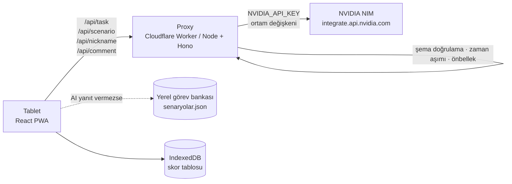

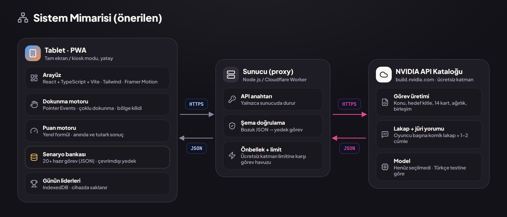
*Kulüp tasarımı v0.2: Tablet PWA ↔ proxy (Node.js / Cloudflare Worker: API anahtarı yalnızca sunucuda, şema doğrulama, önbellek + limit) ↔ NVIDIA API kataloğu.*

Proxy'nin görevleri: anahtarı saklamak, isteği şablona oturtmak, yanıtı **JSON şemasına göre doğrulamak**, 4 sn zaman aşımı, hız sınırı (dakikada en fazla 20 istek), tekrarlanan görevler için kısa önbellek.

### 12.4 Görev JSON şeması (Düello)

```json
{
  "baslik": "Hastane Bilgi Yönetim Sistemi",
  "aciklama": "Hastaların randevu alabildiği, doktorların hasta kayıtlarına güvenle ulaşabildiği bir sistem tasarla.",
  "ikon": "hospital",
  "zorluk": "orta",
  "hedefKitle": [
    { "ad": "Hasta",   "ikon": "user" },
    { "ad": "Doktor",  "ikon": "stethoscope" },
    { "ad": "Hemşire", "ikon": "heart-pulse" }
  ],
  "kartlar": [
    { "id": "randevu", "ad": "Randevu Al", "ikon": "calendar-plus", "nfr": false, "tur": "kritik", "agirlik": 3, "gerekce": "Hastanın ana işlemi" },
    { "id": "sifre",   "ad": "Veri Şifreleme", "ikon": "lock", "nfr": true, "tur": "kritik", "agirlik": 3, "gerekce": "Sağlık verisi KVKK kapsamında" },
    { "id": "sepet",   "ad": "Sepet", "ikon": "shopping-cart", "nfr": false, "tur": "tuzak", "agirlik": 0, "gerekce": "Hastanede alışveriş akışı yoktur" }
  ],
  "birlesimler": [
    { "ad": "Doğru kişi doğru veri", "kartlar": ["hasta-kaydi", "rbac"] }
  ]
}
```

Doğrulama kuralları: tam 14 kart · 3 kritik + 4 önemli + 1 destekleyici + 6 tuzak · ağırlık toplamı 18 · kart adı ≤ 2 kelime · ikon izin listesinde · birleşimdeki kart id'leri gerekli kartlar arasında. Doğrulamadan geçmeyen yanıt atılır ve bankadan görev gelir.

### 12.5 Senaryo JSON şeması

```json
{
  "baslik": "Yemekhane: Öğle Saati Krizi",
  "sistem": "yemekhane",
  "adimlar": [
    {
      "no": 1,
      "seviye": "detay",
      "durum": "Öğrenciler turnikeden nasıl geçsin?",
      "secenekler": [
        { "id": "a", "metin": "NFC kart / telefon", "ikon": "nfc",       "puan": 20, "etki": "Kuyruk akıyor." },
        { "id": "b", "metin": "QR kod",             "ikon": "qr-code",   "puan": 14, "etki": "Ekranı karanlık telefonlarda okuma sorunu." },
        { "id": "c", "metin": "Kimlik no ile görevli", "ikon": "id-card", "puan": 4,  "etki": "Kuyruk kapıya kadar uzadı." },
        { "id": "d", "metin": "Yüz tanıma",         "ikon": "scan-face", "puan": 6,  "etki": "KVKK açık rıza sorusu gündeme geldi." }
      ]
    }
  ]
}
```

Doğrulama kuralları: tam 5 adım · adım 1–4 `detay`, adım 5 `genel` · her adımda 4 seçenek · her adımda tam bir seçenek 20 puan · seçenek metni ≤ 6 kelime.

### 12.6 Promptlar (taslak)

**Görev üretimi (sistem promptu):**

```text
Sen bir yazılım gereksinim analizi oyununun görev tasarımcısısın. Türkçe yaz.
Lise ve üniversite öğrencilerinin anlayacağı, gerçek hayattan bir mobil/web uygulama görevi üret.
Görev şu sistemlerden birine ya da yakın bir varyasyonuna dayansın: kütüphane, yemekhane, kafe, hastane, mağaza.
Kartları ÖNCELİKLE verilen katalogdan seç. Yeni kart gerekiyorsa ikonunu yalnızca izin listesinden seç.
Tam 14 kart üret: 8 gerekli (3 kritik=3, 4 önemli=2, 1 destekleyici=1) ve 6 tuzak.
Tuzakların en az 2 tanesi konuyla ilgili görünen ama bu hedef kitleye değer katmayan kartlar olsun.
En az 1 gerekli kart fonksiyonel olmayan gereksinim (nfr=true) olsun.
Kart adları en fazla 2 kelime. 2-3 birleşim (birbirini tamamlayan kart çifti) tanımla.
Şiddet, tıbbi teşhis, siyaset ve marka adı içerme.
YALNIZCA verilen JSON şemasına uygun JSON döndür; açıklama ekleme.
```

**Takma ad üretimi:**

```text
Bir üniversite stant oyunundaki iki oyuncu için eğlenceli, sevimli Türkçe takma ad üret.
Yazılım/teknoloji esprisi içersin (bug, commit, deploy, cache, null gibi) ve bir hayvan ya da karakterle birleşsin.
Her biri 2-3 kelime, en fazla 20 karakter. Kimseyi aşağılama; küfür, dış görünüş, din, siyaset, cinsiyet, gerçek kişi ve marka adı kullanma.
Şu adları tekrar etme: {son_50_ad}
Yalnızca JSON döndür: {"oyuncu1": "...", "oyuncu2": "..."}
```

**Senaryo üretimi:**

```text
Sen bir yazılım gereksinim analizi senaryo oyununun tasarımcısısın. Türkçe yaz.
Sistem: {sistem}. Kaynak gereksinimler: {pdf_ozet}.
5 adımlı, tek oyunculu bir karar senaryosu üret. Adım 1-4 somut ve detaylı gereksinim kararları sorsun
(hangi giriş yöntemi, hangi veri gösterilmeli, bir hata/yoğunluk anında ne yapılmalı).
Adım 5 sistemin bütününe dair genel bir karar sorsun (en kritik fonksiyonel olmayan gereksinim ya da öncelik).
Her adımda 4 seçenek: 1 en iyi (20 puan), 1 makul (10-14), 2 zayıf (0-8). En iyi seçenek her zaman aynı sırada olmasın.
Her seçenek için tek cümlelik "etki" yaz: seçimin kısa vadeli sonucu. Etki doğru/yanlış demesin, sonucu anlatsın.
YALNIZCA verilen JSON şemasına uygun JSON döndür.
```

**Lakap ve jüri yorumu:**

```text
Sen bir uygulama tasarım yarışmasının esprili jürisisin. Türkçe yaz.
Aşağıda her oyuncunun seçtiği kartlar (id) ve puan dökümü var.
Her oyuncuya BU turdaki seçimlerine dayanan 2-4 kelimelik komik bir lakap ve en fazla 2 cümlelik bir jüri yorumu yaz:
bir içten övgü + bir tatlı takılma. Asla aşağılama; küfür, dış görünüş, din, siyaset ve gerçek kişi yok.
Yalnızca JSON döndür: {"oyuncu1": {"lakap": "...", "yorum": "..."}, "oyuncu2": {"lakap": "...", "yorum": "..."}}
```

Çağrı başarısız olursa ya da lakap kelime filtresine takılırsa puan aralığına göre hazır bir lakap seçilir (ör. 90+ *"Uygulama Sihirbazı"*, 0–30 *"Sepetçi Başı"*).

### 12.7 Yedek plan

- Stanttan önce **30–50 görev ve 15–20 senaryo** yapay zekâyla üretilir, kulüp tarafından gözden geçirilip `src/data/` altındaki görev bankasına eklenir.
- Etkinlikte canlı üretim ve banka birlikte çalışır. AI yanıtı 4 sn'yi geçerse ya da şema doğrulamasından geçmezse bankadan içerik gelir; oyuncu farkı hissetmez.
- İnternet tamamen yoksa uygulama yalnızca bankayla eksiksiz oynanır. Takma adlar ve yorumlar yerel şablonlardan üretilir.

---

## 13. Teknik Mimari

### 13.1 Neden React?

React doğru seçim; değiştirmeye gerek yok. 10 günlük süre, ekibin React bilgisi, olgun kütüphaneler (ikon, animasyon, durum yönetimi) ve kolay PWA kurulumu belirleyici. Performans bu oyunun darboğazı değil: ekranda en fazla ~40 kart ve iki sürükleme var.

| Alternatif | Neden şimdilik değil |
|---|---|
| Svelte / SolidJS | Daha küçük paket, ama ekibin öğrenme süresi 10 günlük takvime sığmaz |
| Flutter | Tablet için güçlü, ama web/PWA kurulumu ve Türkçe font ayarı daha zahmetli |
| Unity / oyun motoru | Bu ölçek için gereksiz ağır |

### 13.2 Teknoloji yığını

| Katman | Seçim | Gerekçe |
|---|---|---|
| Önyüz | React 18 + TypeScript + Vite | Hızlı geliştirme, tip güvenliği |
| Stil | Tailwind CSS + CSS değişkenleri (tasarım token'ları) | Referans tasarımdaki `base.css` token'larıyla uyumlu |
| İkonlar | `lucide-react` | Tutarlı çizgi stili, ağaç sarsma (tree-shaking) |
| Animasyon | Framer Motion | Kart kaldırma/bırakma yayları, puan halkası, konfeti |
| Durum | Zustand (her oyuncu için ayrı store) | Basit; iki oyuncunun durumu tam ayrık |
| Sürükle-bırak | Özel Pointer Events katmanı (~150 satır) | Aynı anda iki parmak, iki ayrı sürükleme gerekir; hazır kütüphaneler çoğunlukla tek aktif sürükleme varsayar |
| Şema doğrulama | Zod | AI yanıtlarını önyüzde ve proxy'de doğrulamak için |
| Yerel veri | IndexedDB (Dexie) | Skor tablosu internet olmadan da kalıcı |
| PWA / kiosk | `vite-plugin-pwa` | Çevrimdışı açılış, tam ekran, ana ekrana ekleme |
| Proxy | Cloudflare Worker (ücretsiz) veya Node + Hono | API anahtarını saklar |
| Paylaşım görseli | `html-to-image` | İlk 3 için Instagram görseli |
| (Opsiyonel) Bulut skor | Supabase ücretsiz katman | Birden fazla tablet kullanılırsa ortak skor tablosu |

### 13.3 Klasör yapısı

```
buildarena/
├─ public/
│  ├─ logo/atu_techbuilders_logo.png
│  └─ sounds/ (tik.mp3, tiktak.mp3, fanfar.mp3)
├─ src/
│  ├─ app/            # yönlendirme, ekran geçişleri
│  ├─ screens/        # Onboarding (tutorial), Home, DuelIntro, DuelGame, DuelResult,
│  │                  # ScenarioNickname, ScenarioGame, ScenarioResult, Leaderboard, Admin
│  ├─ components/     # Card, PhoneBox, TimerRing, ScoreRing, Chip, PlayerHeader, ChainView
│  ├─ game/
│  │  ├─ scoring.ts        # düello ve senaryo puan motoru (saf fonksiyonlar + birim testler)
│  │  ├─ touchIsolation.ts # pointerId → oyuncu eşlemesi, sınır kilidi, ölü bölge
│  │  └─ drag.ts           # Pointer Events tabanlı sürükle-bırak
│  ├─ stores/         # player1Store, player2Store, roundStore, scenarioStore
│  ├─ ai/             # api istemcisi, Zod şemaları, yedek mantığı
│  ├─ data/
│  │  ├─ tutorial.json     # tutorial slaytlarının metinleri ve süreleri
│  │  ├─ cards.json        # Bölüm 9 kart kataloğu
│  │  ├─ tasks.json        # düello görev bankası
│  │  ├─ scenarios.json    # senaryo bankası
│  │  ├─ nicknames.json    # yedek takma adlar
│  │  └─ badwords.json     # takma ad filtresi
│  ├─ db/             # Dexie: skor tablosu
│  └─ styles/tokens.css
├─ proxy/             # Cloudflare Worker / Hono
└─ tests/
```

### 13.4 Durum modeli

```ts
type PlayerId = 1 | 2;

interface PlayerState {
  nickname: string;
  pool: string[];        // kart id'leri, oyuncuya özel karıştırılmış
  box: string[];         // en fazla 8
  finishedAt?: number;   // kalan süre (sn)
  history: string[][];   // geri al için
}

interface RoundState {
  task: Task;            // Zod ile doğrulanmış görev
  durationSec: number;
  startedAt: number;
  phase: 'intro' | 'countdown' | 'playing' | 'scoring' | 'result';
}
```

Ortak veri yalnızca görev ve süredir; oyuncu durumları birbirine hiç dokunmaz.

### 13.5 Ekran izolasyonu (oyuncular birbirine müdahale edemez)

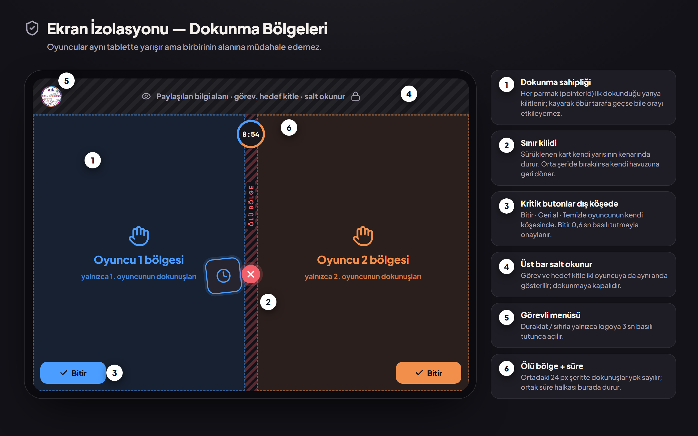

| Kural | Uygulama |
|---|---|
| Dokunma sahipliği | `pointerdown` anında x koordinatına göre sahip (1/2) belirlenir ve `pointerId`'ye bağlanır; o parmağın sonraki hareketleri yalnızca o oyuncuyu etkiler |
| Sınır kilidi | Sürüklenen kart kendi yarısının sınırları içinde tutulur (clamp); orta şeride bırakılan kart havuza geri uçar |
| Ölü bölge | Ortadaki 24 px şeritte başlayan dokunuşlar yok sayılır |
| Tek parmak | Her oyuncu aynı anda 1 kart sürükleyebilir; ikinci parmak yok sayılır |
| Avuç içi reddi | Temas alanı çok büyük dokunuşlar (`width/height` > 60 px) yok sayılır |
| Kritik butonlar | Bitir 0,6 sn basılı tutmayla onaylanır |
| Görevli menüsü | Logoya 3 sn basılı tut + PIN |
| Tarayıcı hareketleri | `touch-action: none`, kaydırma/yakınlaştırma/uzun basma menüsü/metin seçimi kapalı |
| Cihaz kilidi | iPad'de "Rehberli Erişim", Android'de "Uygulama sabitleme" |

---

## 14. Tasarım Sistemi

Tasarım, kulübün **v0.2 tasarım sistemini** izler: vurgu renkleri kulüp logosundan gelen sakin bir grafit tema. Kurallar: düz (flat) yüzeyler ve ince çizgiler; keskin renk yalnızca dokunulan öğede; neon mor–camgöbeği gradyanlar, parlama (glow) gölgeleri ve ✨ "AI" etiketleri yok.

### 14.1 Logo


- Dosya: `assets/logo/atu_techbuilders_logo.png` (1280×1280 px, kulübün v0.2 dosyası).
- Logodaki "ATU" yazısı "ATÜ" olarak güncellendi; noktalar harfin renk geçişine göre çizildi. Dış beyaz alan şeffaf, logo doğrudan koyu zemine oturur. Logonun başka hiçbir öğesi değiştirilmedi.
- Logo yeniden renklendirilmez, kırpılmaz, döndürülmez.
- Büyük baskılar için vektör (SVG) bir sürüm hazırlanması yine önerilir.

### 14.2 Renk paleti (v0.2, logodan türetildi)

Kontrast oranları `#131218` zeminine göre ölçülmüştür; tüm metin renkleri WCAG AA'yı (≥ 4,5:1) geçer.

| Token | Hex | Kontrast | Kullanım |
|---|---|---|---|
| `--bg` | `#131218` | — | Tüm ekranların zemini (hafif sıcak grafit; stant ışığında parlamaz) |
| `--surface` / `--surface-2` / `--surface-3` | `#1E1D25` / `#26242E` / `#312E3A` | — | Kart, panel, buton, çip |
| `--paper` | `#FAF8F5` | — | Telefon ekranı ve açık kartlar |
| `--text` | `#F5F2ED` | 16,7:1 | Metin |
| `--muted` | `#A8A3B3` | 7,6:1 | İkincil metin |
| `--dim` | `#8A859C` | 5,3:1 | Soluk metin |
| `--p1` | `#4B9EFF` | 6,8:1 | Oyuncu 1 (logo mavisi): rozet, süre çubuğu, Bitir, sürükleme halkası |
| `--p2` | `#F28F4B` | 7,8:1 | Oyuncu 2 (logo bakırı) |
| `--brand` | `#E2498F` | 5,0:1 | Logo pembesi: "Arena", Rövanş, Senaryo, vurgu |
| `--brand-btn` | `#C93A7C` | 4,8:1 (beyaz yazı) | Beyaz yazılı pembe buton zemini |
| `--ok` / `--bad` / `--warn` | `#3FC79A` / `#F2616B` / `#F5C451` | 8,7:1 / 5,9:1 / 11,4:1 | Doğru / gereksiz / kazanan (yalnızca sonuçta) |

Renk eşlemesi: mavi → Oyuncu 1 · bakır → Oyuncu 2 · pembe → marka, Rövanş, Senaryo · mor + turkuaz → yalnızca logo ve konfeti.

Oyuncu renkleri mavi–bakır çiftidir; renk körlüğünde de ayırt edilir. Oyuncu rengi her zaman numarayla (1/2) birlikte kullanılır.

### 14.3 Tipografi ve ikonlar

- **Plus Jakarta Sans** (yerel olarak paketlenir): Türkçe karakter desteği tam. Ekran başlığı 62 px / 800, lakap ve başlık 24–34 px, gövde 16 px / 500, etiket 11–12 px.
- **JetBrains Mono:** kronometre ve puanlar (rakamlar titremez).
- **Lucide ikonları:** her kart = 1 ikon + en fazla 2 kelime.
- Ölçüler: köşe yarıçapı 10/16/24/32 px · boşluk ölçeği 4–8–12–16–24–32 px · en küçük dokunma alanı 56×56 px.

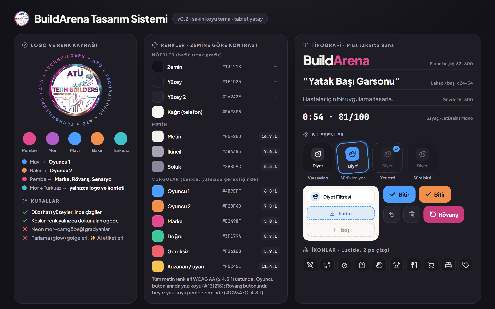
*BuildArena tasarım sistemi v0.2: logo ve renk kaynağı, kontrast oranlarıyla renkler, tipografi, bileşenler ve ikonlar.*

### 14.4 Hareket ve ses

| Öğe | Animasyon | Süre |
|---|---|---|
| Dönen yazı | "ATÜ • TECHBUILDERS" yazısı logonun çevresinde saat yönünde döner | 26 sn/tur |
| Logo konfetisi | Yıldız, dokunaç uçları ve beyinden sırayla mini konfeti | ~1,2 sn arayla |
| Kart kaldırma | %6 büyüme + hafif eğim + oyuncu renginde ince halka (parlama yok) | 120 ms |
| Kart bırakma | Slota yaylı "yapışma" | 180 ms |
| Geçersiz bırakma | Kart havuzdaki yerine geri uçar | 250 ms |
| Senaryo seçimi | Seçilen kart büyür, diğerleri söner; etki kartı aşağıdan kayar | 300 ms + 1,5 sn |
| Son 10 saniye | Kronometre kırmızı + nabız | 1 sn döngü |
| Sonuç açılışı | Puan halkası dolar ve sayı sayar; döküm çubukları dolar; lakap damgalanır; jüri yorumu daktiloyla yazılır | 0–2,1 sn → |
| Kazanan | Taç düşer + logo renklerinde konfeti | 1,7–5 sn |

Ses (opsiyonel): bırakmada kısa "tık", son 10 saniyede "tik-tak", kazanana kısa fanfar. Stant gürültüsünde ayarlardan kapatılabilir.

---

## 15. Claude Code ve Skill'lerle Geliştirme

Ekranların kodlanması Claude Code ile yapılabilir. Proje klasörüne şunlar konur ve Claude Code'a referans olarak verilir:

- Bu doküman (`BuildArena_Proje_Dokumani.md`)
- `assets/ekranlar/` altındaki referans ekranlar ve tasarım zip'indeki `tasarim_kaynak/` HTML dosyaları ile `base.css`
- `assets/logo/atu_techbuilders_logo.png`

### 15.1 Kullanılacak skill'ler

| Skill | Ne için |
|---|---|
| **frontend-design** | Ekranların özgün, şablon görünmeyen görsel tasarımı; tipografi ve renk kararları. Referans HTML'ler ve Bölüm 14 paleti ile birlikte verilir. |
| Kulübün UI/UX tasarım skill'i (kurulduysa) | Bileşen kütüphanesi ve erişilebilirlik denetimi |
| **dataviz** | Sonuç ekranındaki puan halkası, puan dökümü ve kelebek etkisi zinciri gibi veri görselleri |
| **pdf** / **docx** | Bu dokümanın kulüp içi PDF/Word kopyasını çıkarmak gerekirse |

### 15.2 Başlangıç promptu

```text
BuildArena adlı, tablette yatay çalışan bir React + TypeScript + Vite + Tailwind PWA oluştur.
Tüm ürün kuralları BuildArena_Proje_Dokumani.md dosyasındadır; önce onu oku.
Tasarım referansı: tasarim_kaynak/ klasöründeki v0.2 HTML ekranları ve base.css (palet: 14.2 bölümü).
Yerleşimi, bileşen ölçülerini ve v0.2 kurallarını (düz yüzey, parlama yok, neon gradyan yok) koru. frontend-design skill'ini kullan.
Logo: public/logo/atu_techbuilders_logo.png — üzerinde hiçbir değişiklik yapma.

Ekranlar: İlk açılış tutorial'ı (5 slayt, üstte segmentli slayt bar, Atla/Geri/İleri, kaydırma, otomatik ilerleme),
Ana Ekran, Düello (görev kartı → oyun → sonuç), Senaryo (takma ad → 5 adım → sonuç),
Skor Tablosu, Görevli Menüsü (PIN).

Düello ekranı ikiye bölünür: Oyuncu 1 solda (havuz + kutu), Oyuncu 2 sağda (simetrik).
Üst panelde görev adı ve kronometre. Her yarı yalnızca kendi oyuncusunun dokunuşlarını kabul eder
(pointerId → oyuncu eşlemesi, sınır kilidi, ortada 24 px ölü bölge, tek parmak kuralı).
Sürükle-bırakı Pointer Events ile kendin yaz; iki oyuncu aynı anda sürükleyebilmeli.

Kartlar: 1 ikon (lucide-react) + en fazla 2 kelime, NFR kartlarda küçük rozet. Dokunma alanı en az 56 px.
Puanlama dokümandaki formüle göre src/game/scoring.ts içinde saf fonksiyonlarla hesaplanır ve birim testi yazılır.
Görevler /api/task, senaryolar /api/scenario, takma adlar /api/nickname, yorumlar /api/comment uç noktalarından gelir;
Zod ile doğrula, 4 sn'de yanıt yoksa src/data/*.json bankasını kullan.
Skor tablosu Dexie (IndexedDB) ile saklanır. Tüm arayüz metinleri Türkçe.
```

### 15.3 Claude Code ile çalışma düzeni

- Claude Code'a her seferinde **tek bir iş paketi** verin (Bölüm 16): *"İP-06'yı yap: kapsam ve bitti kriteri dokümanda."* Küçük ve test edilebilir adımlar, büyük tek seferlik istemlerden çok daha iyi sonuç verir.
- Her iş paketi ayrı bir Git dalında (`ip-06-surukle-birak` gibi) geliştirilir; bitti kriteri sağlanınca ana dala birleştirilir.
- Etkileşim gerektiren paketler (İP-06 sürükle-bırak, İP-07 düello akışı) her zaman **gerçek tablette, iki kişiyle** test edilir; tarayıcı simülasyonu yeterli değildir.

---

## 16. Geliştirme Planı: Öncelik Sıralı İş Paketleri

Proje, sırayla ve öncelik seviyesine göre yapılacak **17 iş paketine (İP)** bölündü. Sıralamanın tek bir ilkesi var: **önce yapay zekâ olmadan, internetsiz oynanabilen bir oyun; sonra yapay zekâ; en son cila.** Böylece hangi aşamada zaman biterse bitsin, stantta oynanabilir bir sürüm olur.

### 16.1 Öncelik seviyeleri

| Seviye | Anlamı | Kural |
|---|---|---|
| **P0 — Olmazsa olmaz** | Stantta oyunun oynanabilmesi için şart | Hiçbir koşulda kesilmez; diğer her şeyden önce biter |
| **P1 — Önemli** | Yapay zekâ, skor tablosu, tutorial, görevli araçları | Zaman daralırsa küçültülür ama tamamen kesilmez |
| **P2 — Cila** | Animasyon, ses, konfeti, bekleme modu | Zaman kalırsa yapılır |
| **P3 — Opsiyonel** | Bulut skor tablosu, QR ile sonuç kartı, büyük ekrana yansıtma | Stant sonrasına ertelenebilir |

### 16.2 Özet tablo

| No | İş paketi | Öncelik | Bağımlılık | Tarih | Ekip |
|---|---|---|---|---|---|
| İP-01 | Kararlar ve hazırlık | P0 | — | 25 Eki | Hepsi |
| İP-02 | Proje iskeleti ve tasarım token'ları | P0 | İP-01 | 26 Eki | B |
| İP-03 | Veri katmanı: kart kataloğu, görev ve senaryo bankası | P0 | İP-01 | 26–27 Eki | C |
| İP-04 | Ortak arayüz bileşenleri | P0 | İP-02 | 26–27 Eki | B |
| İP-05 | Ana ekran | P0 | İP-04 | 27 Eki | B |
| İP-06 | Sürükle-bırak ve ekran izolasyonu | P0 · **en riskli** | İP-04 | 28–29 Eki | A |
| İP-07 | Düello akışı (görev kartı → oyun) | P0 | İP-03, İP-06 | 28–29 Eki | A |
| İP-08 | Puan motoru ve birim testleri | P0 | İP-03 | 28 Eki | C |
| İP-09 | Düello sonuç ekranı | P0 | İP-07, İP-08 | 29 Eki | B |
| | **Kilometre taşı M1 — Çevrimdışı oynanabilir Düello** | | | **29 Eki** | |
| İP-10 | Senaryo modu | P0 | İP-03, İP-04, İP-08 | 30 Eki | A + B |
| | **Kilometre taşı M2 — Çevrimdışı oynanabilir Senaryo** | | | **30 Eki** | |
| İP-11 | Proxy ve NVIDIA NIM bağlantısı | P1 | İP-01 | 30–31 Eki | C |
| İP-12 | Yapay zekâ içerikleri (görev, senaryo, takma ad, yorum) | P1 | İP-11 | 31 Eki – 1 Kas | C |
| | **Kilometre taşı M3 — Canlı yapay zekâ** | | | **1 Kas** | |
| İP-13 | Skor tablosu ve ilk 3 dışa aktarma | P1 | İP-10 | 31 Eki | B |
| İP-14 | İlk açılış tutorial'ı (slayt bar) | P1 | İP-04 | 1 Kas | B |
| İP-15 | Görevli menüsü ve kiosk modu | P1 | İP-09, İP-13 | 1 Kas | A |
| İP-16 | Animasyon, ses ve bekleme modu | P2 | İP-09, İP-14 | 1–2 Kas | B |
| İP-17 | Test turnuvası, hata düzeltme ve stant kurulumu | P0 · kapı | Hepsi | 2–3 Kas | Hepsi |
| | **Kilometre taşı M4 — Stant hazır** | | | **3 Kas** | |

**Ekip önerisi (3 alt ekip):** **A — Etkileşim** (oyun mantığı, dokunma, akışlar) · **B — Arayüz** (bileşenler, ekranlar, animasyon) · **C — Veri ve yapay zekâ** (JSON verisi, puan motoru, proxy, promptlar). Kulüp 2 kişiyle çalışacaksa A ve B birleşir; 4+ kişiyse İP-10 ve İP-13 ayrı kişilere verilir.

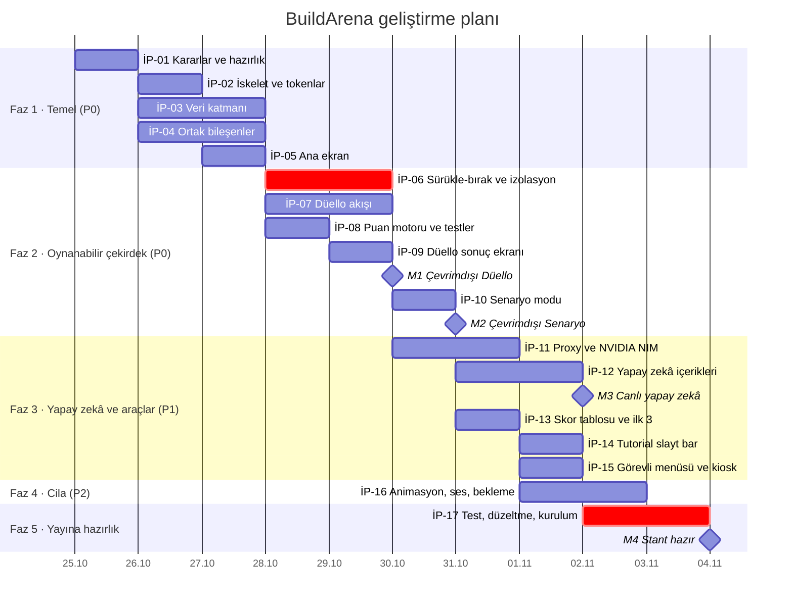

### 16.3 İş paketlerinin ayrıntısı

#### İP-01 · Kararlar ve hazırlık — P0

- Uygulama adı, tur süreleri ve renk paletinin onayı; dokümanın v1.1 olarak kilitlenmesi.
- Git deposu (GitHub), dal kuralı (`ip-XX-kisa-ad`), görev panosu (İP'ler kart olarak).
- NVIDIA build.nvidia.com hesabı ve API anahtarı; 2–3 modelin aynı görev promptuyla denenmesi (Bölüm 12.2).
- Hangi tabletin kullanılacağının netleşmesi (ekran ölçüleri buna göre ayarlanır).
- **Bitti sayılır:** model seçildi, depo açıldı, herkes kendi paketini biliyor.

#### İP-02 · Proje iskeleti ve tasarım token'ları — P0

- Vite + React + TypeScript + Tailwind kurulumu; ESLint ve Prettier.
- `tokens.css`: Bölüm 14.2 renkleri, köşe yarıçapları, boşluk ölçeği; Plus Jakarta Sans ve JetBrains Mono fontları **yerel** olarak paketlenir (stantta internet olmayabilir).
- `lucide-react`, Framer Motion, Zustand, Zod, Dexie kurulumu; Bölüm 13.3 klasör yapısı.
- Ekranlar arası boş yönlendirme; `vite-plugin-pwa` ile çevrimdışı açılış.
- **Bitti sayılır:** uygulama tablette tam ekran açılıyor, internet kapalıyken de yükleniyor.

#### İP-03 · Veri katmanı — P0

- `cards.json`: Bölüm 9'daki 44 kart (id, ad, ikon, nfr, kaynak sistemler).
- `tasks.json`: Bölüm 10'daki 5 görev (ağırlıklar, tuzaklar, birleşimler).
- `scenarios.json`: Bölüm 7.5'teki 5 senaryo (en az Yemekhane tam yazılı; diğerleri iskeletten tamamlanır).
- `nicknames.json` (yedek takma adlar), `badwords.json` (filtre), `tutorial.json`.
- Zod şemaları (Bölüm 12.4–12.5); tüm JSON'lar uygulama açılışında doğrulanır.
- **Bitti sayılır:** tüm veri dosyaları şema doğrulamasından geçiyor; her görevde ağırlık toplamı 18.

#### İP-04 · Ortak arayüz bileşenleri — P0

- `Card` (ikon + 2 kelime + NFR rozeti, kullanıldı gölgesi), `PhoneBox` (8 slot), `TimerRing`, `ScoreRing`, `Chip`, `PlayerHeader`, `HoldButton` (0,6 sn basılı tut), `Button`.
- Her bileşen tek başına bir test sayfasında görüntülenebilir.
- **Bitti sayılır:** bileşenler referans tasarımlarla (Bölüm 6 ve 14) görsel olarak uyumlu; dokunma alanları ≥ 56 px.

#### İP-05 · Ana ekran — P0

- Logo, BuildArena başlığı, slogan, Düello ve Senaryo butonları, sağ üst ikonlar (Bölüm 5).
- **Bitti sayılır:** iki mod butonu ilgili akışa geçiyor; bilgi butonu (şimdilik) boş tutorial ekranını açıyor.

#### İP-06 · Sürükle-bırak ve ekran izolasyonu — P0 · en riskli

- Pointer Events ile özel sürükle-bırak: `pointerdown` anında sahip oyuncu belirleme, `pointerId` bağlama.
- Sınır kilidi (clamp), ortada 24 px ölü bölge, oyuncu başına tek parmak, avuç içi reddi, `touch-action: none` (Bölüm 13.5).
- Kartı kutuya bırakma, kutu içinde sıralama, kutudan havuza geri sürükleme, geçersiz bırakmada geri uçma.
- **Bitti sayılır:** gerçek tablette **iki kişi aynı anda** sürüklerken hiçbir kart karşı tarafa geçmiyor, hiçbir dokunuş diğer oyuncuyu etkilemiyor. 10 dakikalık serbest test hatasız.

#### İP-07 · Düello akışı — P0

- Görev kartı ekranı, iki "Hazırım" butonu, 3-2-1 geri sayım, ortak kronometre (son 10 sn kırmızı).
- Bitir / Geri al / Temizle; erken bitiren tarafın kilitlenmesi; süre dolunca otomatik değerlendirme.
- Görev şimdilik `tasks.json`'dan rastgele seçilir; kart sırası iki oyuncu için ayrı karıştırılır.
- **Bitti sayılır:** baştan sona bir düello turu yapay zekâ olmadan oynanıyor.

#### İP-08 · Puan motoru ve birim testleri — P0

- `scoring.ts`: düello (50 + 20 + 20 + 10) ve senaryo (5 × 20) formülleri, eşitlik kuralları (Bölüm 11).
- Vitest ile birim testleri: Bölüm 11.1'deki örnek (81 ve 62 puan) birebir doğrulanır; boş kutu, tümü tuzak, süre bonusu koşulu gibi uç durumlar.
- **Bitti sayılır:** tüm testler geçiyor; aynı girdi her zaman aynı puanı veriyor.

#### İP-09 · Düello sonuç ekranı — P0

- Sayı sayan puan halkası, 4 bileşenli döküm, lakap damgası, daktilo efektli jüri yorumu, kazanana taç ve konfeti; Rövanş, Ana Menü, Günün Liderleri (Bölüm 6.5).
- Lakap ve jüri yorumu şimdilik yerel yedek şablonlardan gelir (İP-12'de yapay zekâya bağlanır).
- **Bitti sayılır:** → **M1: Düello internetsiz, baştan sona oynanabilir.**

#### İP-10 · Senaryo modu — P0

- Takma ad ekranı: doğrulama, küfür filtresi, aynı ad için sayı eki, sosyal medya izin kutusu (Bölüm 7.2).
- 5 adımlı akış: durum metni, 4 seçenek, adım süresi (20 sn), kelebek etkisi kartı, karar zinciri; final ekranı ve unvan.
- **Bitti sayılır:** → **M2: Senaryo internetsiz, baştan sona oynanabilir;** sonuç IndexedDB'ye kaydediliyor.

#### İP-11 · Proxy ve NVIDIA NIM bağlantısı — P1

- Cloudflare Worker (ya da Node + Hono): `/api/task`, `/api/scenario`, `/api/nickname`, `/api/comment`.
- API anahtarı ortam değişkeninde; 4 sn zaman aşımı, dakikada 20 istek sınırı, Zod ile yanıt doğrulama.
- Önyüzde yedek mantığı: hata / gecikme → yerel banka; oyuncu farkı hissetmez.
- **Bitti sayılır:** internet kesilip açıldığında oyun hiç takılmadan devam ediyor.

#### İP-12 · Yapay zekâ içerikleri — P1

- Bölüm 12.6'daki promptların modele göre ince ayarı; görev, senaryo, takma ad, lakap ve jüri yorumu üretimi.
- Stanttan önce **30–50 görev ve 15–20 senaryo** üretilip kulüp tarafından okunur; uygun olanlar bankaya eklenir.
- **Bitti sayılır:** → **M3:** 20 ardışık üretimin en az 18'i şemadan geçiyor ve içerik kontrolünden geçiyor.

#### İP-13 · Skor tablosu ve ilk 3 dışa aktarma — P1

- Dexie ile kayıt, sıralama ve eşitlik kuralları; ana ekrandaki kupa ikonu ve "Günün İlk 3'ü".
- Görevli menüsünden günlük sıfırlama (arşivleyerek), uygunsuz kaydı gizleme.
- İzin veren oyunculardan ilk 3 için 1080×1350 ve 1080×1920 PNG paylaşım görseli (Bölüm 8.2).
- **Bitti sayılır:** tablet kapatılıp açıldığında skorlar korunuyor; paylaşım görseli doğru üretiliyor.

#### İP-14 · İlk açılış tutorial'ı (slayt bar) — P1

- `Onboarding.tsx`: 5 slayt, segmentli slayt bar, Atla / Geri / İleri, kaydırma, basılı tutunca duraklama, otomatik ilerleme (Bölüm 4).
- İlk açılış kaydı, "Nasıl Oynanır" ile yeniden açma, hareket azaltma desteği.
- **Bitti sayılır:** yeni bir kullanıcı 30 saniyede tutorial'ı bitirip doğru moda geçebiliyor (3 kişiyle test).

#### İP-15 · Görevli menüsü ve kiosk modu — P1

- Logoya 3 sn basılı tut + PIN; duraklat, turu sıfırla, tutorial'ı sıfırla, ayarlar (süre, zorluk, ses, tam AI puanlaması, bekleme döngüsü).
- iPad Rehberli Erişim / Android Uygulama sabitleme kurulum notları.
- **Bitti sayılır:** ziyaretçi uygulamadan çıkamıyor; görevli her şeyi PIN ile yönetebiliyor.

#### İP-16 · Animasyon, ses ve bekleme modu — P2

- Bölüm 14.4'teki hareketler: kart kaldırma/bırakma, puan halkası, konfeti, son 10 sn nabzı.
- Sesler (tık, tik-tak, fanfar) ve kapatma ayarı; 60 sn bekleme modu ve tutorial döngüsü.
- **Bitti sayılır:** animasyonlar tablette akıcı (takılma yok); ses ayardan kapanıyor.

#### İP-17 · Test turnuvası, hata düzeltme ve stant kurulumu — P0 · kapı

- Kulüp içi turnuva: en az 20 düello ve 20 senaryo turu; süre ve zorluk ayarı; bulunan hataların düzeltilmesi.
- İnternetsiz prova (uçak modu), yedek cihaz kurulumu, kiosk modu, stant kontrol listesi (Bölüm 17.1).
- **Bitti sayılır:** → **M4:** kritik hata yok; uygulama 2 saat kesintisiz çalışıyor.

### 16.4 Zaman daralırsa kesme sırası

Plan geride kalırsa aşağıdaki sırayla küçültülür. **P0 paketleri (İP-06 → İP-10 ve İP-17) asla kesilmez.**

1. **İP-16** yalnızca kart ve puan halkası animasyonlarına indirilir; ses ve konfeti çıkarılır.
2. **İP-14** tutorial 3 slayta indirilir (Hoş geldin · Düello · Senaryo).
3. **İP-12** canlı görev üretimi kapatılır; oyun yalnızca önceden üretilmiş bankayla çalışır, yapay zekâ yalnızca yorum ve takma ad üretir.
4. **İP-13** paylaşım görseli elle hazırlanır (ekran görüntüsü + şablon).
5. **İP-10** senaryo 3 adıma indirilir (2 detay + 1 genel).

---

## 17. Yol Haritası (25 Ekim – 4 Kasım)

Günlük takvim, Bölüm 16'daki iş paketlerinin takvime oturtulmuş halidir.

| Tarih | İş paketleri | Hedef | Çıktı |
|---|---|---|---|
| 25 Ekim (Paz) | İP-01 | Doküman onayı; ad, renk, süre kararları; NVIDIA hesabı + model testi | Doküman v1.1 · seçilen model |
| 26–27 Ekim | İP-02 → İP-05 | Proje iskeleti, token'lar, veri katmanı, bileşenler, Ana Ekran | Tıklanabilir prototip |
| 28–29 Ekim | İP-06 → İP-09 | Sürükle-bırak + izolasyon, düello akışı, puan motoru, sonuç ekranı | **M1:** Çevrimdışı oynanabilir Düello |
| 30 Ekim | İP-10, İP-11 (başlangıç) | Senaryo modu (takma ad, 5 adım, zincir, sonuç); proxy kurulumu | **M2:** Çevrimdışı oynanabilir Senaryo |
| 31 Ekim | İP-11, İP-12, İP-13 | AI görev/senaryo/takma ad/yorum, şema doğrulama, yedek mantığı; skor tablosu | Canlı AI üretimi başladı |
| 1 Kasım | İP-12, İP-14, İP-15, İP-16 | Tutorial (slayt bar), görevli menüsü, ilk 3 dışa aktarma; 30–50 görevin önceden üretilip gözden geçirilmesi; animasyonlar | **M3:** Tam özellikli sürüm |
| 2 Kasım | İP-16, İP-17 | Kulüp içi test turnuvası (en az 20 tur), süre ve zorluk ayarı, hata düzeltme | Test notları |
| 3 Kasım | İP-17 | Tablet kurulumu, kiosk modu, yedek cihaz, çevrimdışı prova | **M4:** Stant hazır |
| **4 Kasım** | — | **Etkinlik** | Günün ilk 3'ü görseli |

### 17.1 Stant kontrol listesi

- [ ] Tablet (tercihen 11" ve üzeri) + sağlam stand/tutucu
- [ ] Şarj adaptörü, uzatma kablosu, yedek tablet veya dizüstü
- [ ] Mobil hotspot (stant interneti zayıfsa)
- [ ] Ekran temizleme mendili (ortak dokunmatik ekran)
- [ ] Görevli PIN'i ekipte paylaşıldı
- [ ] KVKK bilgilendirme notu stantta görünür
- [ ] Opsiyonel: izleyiciler için büyük ekrana yansıtma
- [ ] Opsiyonel: günün ilk 3'üne küçük ödül (sticker, kulüp rozeti)

---

## 18. Riskler ve Önlemler

| Risk | Olasılık | Önlem |
|---|---|---|
| Stantta internet yok / zayıf | Orta | Görev bankası + yerel takma ad ve yorum şablonları; uygulama tamamen çevrimdışı oynanır |
| AI bozuk ya da mantıksız JSON döndürür | Orta | Zod şema doğrulama + bankaya düşme; önceden üretilen içerik insan kontrolünden geçer |
| Ücretsiz kota / hız sınırı | Düşük | Stant trafiği sınırın çok altında; proxy önbelleği; kredi bitse de banka çalışır |
| İki oyuncu aynı anda sürüklerken çakışma | Orta | Özel Pointer Events katmanı + gerçek tablette iki kişiyle erken test (28–29 Ekim) |
| Uygunsuz takma ad skor tablosuna düşer | Orta | Yerel kelime filtresi + AI denetimi + görevli menüsünden kayıt gizleme |
| Puana itiraz | Düşük | Hibrit puanlama: aynı tasarım hep aynı puanı alır; sonuç ekranında puan dökümü görünür |
| Tablet donar / pil biter | Düşük | Yedek cihaz, sürekli şarj, skorlar IndexedDB'de kalıcı |

---

## 19. Açık Sorular

| Soru | Önerimiz |
|---|---|
| Uygulamanın adı ne olacak? | "BuildArena". Alternatifler: AppDüello, Gereksinim Avcısı, TechBuild Arena |
| Hangi tablet kullanılacak? | 11" ve üzeri; Düello için ekran boyutu kritik |
| Stantta güvenilir internet var mı? | Yoksa banka + hotspot; oyun yine eksiksiz oynanır |
| Düello sonuçları da skor tablosuna girsin mi? | Ayrı "Günün Düelloları" listesi; sosyal medya ilk 3'ü yalnızca Senaryo'dan |
| Tur süreleri? | Düello 90 sn, Senaryo adım başına 20 sn; 2 Kasım testinde ayarlanır |
| Tam AI puanlaması açık olsun mu? | Varsayılan hibrit; tam AI ayarlardan açılabilir |
| Ödül verilecek mi? | Günün ilk 3'üne küçük hediye; katılımı artırır |
| Hangi NVIDIA modeli? | 25 Ekim'de 2–3 aday aynı promptla test edilip seçilir (Bölüm 12.2) |

---

### Dosyalar

| Yol | İçerik |
|---|---|
| `BuildArena_Proje_Dokumani.md` / `.pdf` | Bu doküman (Markdown ve PDF) |
| `BuildArena_Project_Document_EN.md` | Dokümanın İngilizce sürümü |
| `assets/logo/atu_techbuilders_logo.png` | "ATÜ" olarak güncellenmiş kulüp logosu |
| `assets/ekranlar/01–08_*.png` | Kulübün v0.2 ekran tasarımları (ana ekran, görev kartı, düello, sonuç, dokunma bölgeleri, tasarım sistemi, kullanıcı akışı, mimari) |
| `assets/ekranlar/09–10_*.png` | Tutorial ekranı ve beş tutorial slaytı (v0.2 stili) |
| `assets/tasarim_kaynak/09_tutorial.html` | Tutorial ekranının HTML kaynağı (`?s=1`…`?s=5` ile slayt seçilir) |

### Kaynaklar

- Kulüp içi kaynak: *Yazılım Gereksinimleri ve Sistem Örnekleri* (Kütüphane, Yemekhane, Kafe, Hastane, Mağaza gereksinimleri)
- Kulüp içi kaynak: *BuildArena Dokümantasyon v0.1* ve `tasarim_kaynak/` ekran tasarımları
- [NVIDIA Build — model kataloğu](https://build.nvidia.com)
- [NVIDIA Build Free API: 100+ AI Models on DGX Cloud (2026 Guide)](https://pasqualepillitteri.it/en/news/1621/nvidia-build-free-api-100-ai-models-2026)
- [NVIDIA Developer Forum — NIM API hız sınırı (40 RPM) talepleri](https://forums.developer.nvidia.com/t/request-for-nvidia-nim-api-rate-limit-increase-40-200-rpm/375340)
- [Lucide ikon kütüphanesi](https://lucide.dev/icons/)

---

<div align="center">
<sub>ATÜ TechBuilders · Yazılım üretir, kampüse değer katarız.</sub>
</div>
