# BuildArena — Scenario Mode

**Crisis scenarios, leaderboard and the day's top 3 for social media — product, design and prototype
document.** Project 2 of 2 · single-player decision game · playable prototype included.

> English edition of the club's original Turkish document (v0.1, 25 October 2026), which is kept
> as [`BuildArena_Scenario_Mode_TR.pdf`](BuildArena_Scenario_Mode_TR.pdf) /
> [`.docx`](BuildArena_Scenario_Mode_TR.docx). It describes the mode as it was **planned**; the
> shipped game follows it with the deviations the club agreed later, listed in
> [`AGENTS.md`](../../AGENTS.md) and the [README](../../README.md): **no API and no AI** (scenarios,
> scoring, jury comments and the nickname filter are all local), the "Renk Paleti" paper-and-ink
> design instead of the dark v0.2 theme, the tablet's own keyboard instead of an on-screen one,
> 16 scenarios instead of 5, a redesigned score with difficulty weights, and English data keys.

| Version | Date            | Source                                                                          | Prepared by                    |
| ------- | --------------- | ------------------------------------------------------------------------------- | ------------------------------ |
| 0.1     | 25 October 2026 | BuildArena Project Document v1.2 (sections 7, 8, 11.2, 12) + v0.2 design system | ATÜ TechBuilders software team |

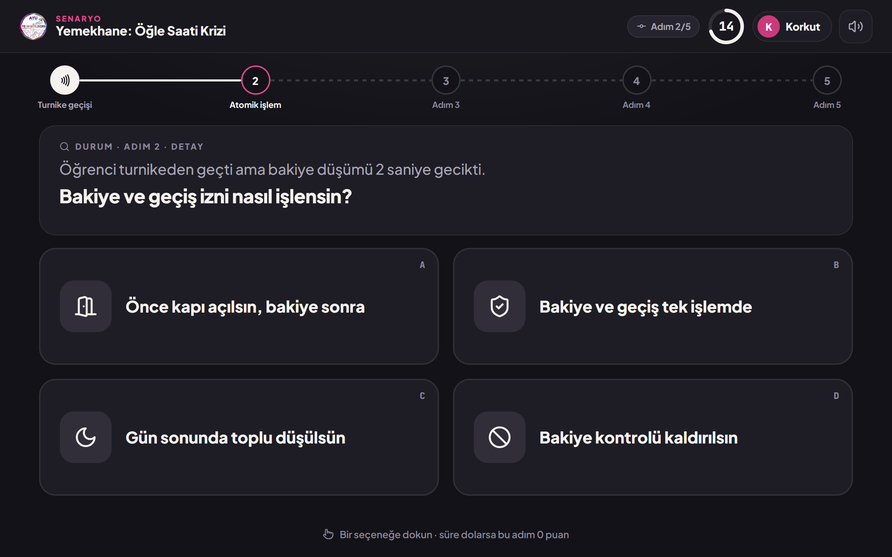

_Figure 1 — Decision step: situation, question, four options and the 20-second timer ring._

## 1. At a glance

Scenario mode is BuildArena's single-player mode. The player types a nickname, the crisis wheel picks
a crisis in one of five campus systems (e.g. "Cafeteria: lunch-hour crisis"), and then the player
makes 5 decisions of 20 seconds each. After every choice a short "butterfly effect" card shows its
consequence. At the end the decision chain is drawn, a score out of 100 is computed from the AI's
scoring key, a title is awarded and the result goes on the leaderboard. At the end of the day the
top 3 among the players who agreed to be shared are exported as ready-made images for the club's
social media accounts.

| Topic            | Decision                                                                                                 |
| ---------------- | -------------------------------------------------------------------------------------------------------- |
| Players          | 1; a nickname is required at the start (3–16 characters)                                                 |
| Length and steps | 5 steps × 20 s ≈ 2.5 minutes · every step: situation + question + 4 options with icons                   |
| Order            | Steps 1–4 detail (feature, data, flow) · step 5 general (non-functional requirement / priority)          |
| Scenarios        | Cafeteria · Library · Café · Hospital · Store — all five written in full (section 5)                     |
| Score            | 5 × 20 = 100; a step whose time runs out scores 0; 5 title levels                                        |
| Leaderboard      | Nickname · score · title · scenario · time; podium + list + scenario filter                              |
| Social media     | Top 3 of those who consented → 1080×1350 post + 1080×1920 story PNG; the team checks them and posts them |

### 1.1 Requests and how they are met

| The club asked for                                                   | How it is met                                                                                                                                                           | Section   |
| -------------------------------------------------------------------- | ----------------------------------------------------------------------------------------------------------------------------------------------------------------------- | --------- |
| The AI scores the scenario out of 100 and it goes on the leaderboard | Hybrid scoring: the AI sets every option's points in advance, the total is computed instantly; the AI writes an analysis. The result is saved and the rank is animated. | 3.6 · 6   |
| Nicknames on the leaderboard                                         | A nickname is required; the board shows nicknames only.                                                                                                                 | 3.1 · 3.7 |
| A nickname is typed when entering a scenario                         | In-app Turkish Q keyboard, live rules, profanity filter, automatic suffix for a taken name (Korkut_2), random name from a dice.                                         | 3.1 · 7   |
| The top 3 are shared on social media                                 | Staff menu "Export the top 3": ready post and story images for the top 3 who consented.                                                                                 | 3.8 · 8   |
| A leaderboard for scenario mode                                      | Podium (1–2–3) + list from 4th place + scenario filter + "YOU" highlight.                                                                                               | 3.7       |
| Questions in a "a crisis broke out" style                            | Every scenario opens with a crisis (time, place, scale); each of the 5 decisions is a moment of that crisis.                                                            | 3.3 · 5   |
| Design following our v0.2 system                                     | Every screen uses the v0.2 tokens (logo palette, calm graphite background, no "AI" sparkle).                                                                            | 11        |
| As much animation and effect as possible                             | Flying butterfly, crisis alarm, wheel, 3-2-1, stamp, confetti, counters, rising podium and sounds: 30+ motions.                                                         | 10        |

## 2. The core of the game

Scenario mode is inspired by the "butterfly effect": every decision shapes the next situation, and
at the end the chain of consequences is drawn. Instead of general-knowledge questions it moves from
detailed requirement decisions to the big picture: the first four steps ask about a concrete feature
(which entry method, which screen, which data, what to do in a crisis), the fifth is a decision about
the system as a whole (the most critical non-functional requirement).

### 2.1 Rules

| Rule                  | Value                                                                                                                   |
| --------------------- | ----------------------------------------------------------------------------------------------------------------------- |
| Step time             | 20 seconds; in the last 5 seconds the timer ring turns red and a tick-tock starts                                       |
| Choice                | The tapped option locks; it can't be undone                                                                             |
| When time runs out    | The step scores 0; a "time ran out" node in the chain; card: "No decision was made; the crisis grew on its own."        |
| Feedback              | Right/wrong is never said during the game; only the short-term effect of the decision is shown                          |
| Butterfly effect card | After every choice; stays 2.6 s, a tap skips it (see 2.2)                                                               |
| Option spread         | Every step has 1 best (20), 1 reasonable (10–14) and 2 weak (0–8) options; the best one is not always in the same place |
| Playing again         | The crisis wheel never picks the scenario last played on the same device; the AI may vary texts and option order        |

### 2.2 A deliberate deviation from the source document

**Butterfly effect card: 2.6 s instead of 1.5 s.** Project document v1.2 suggests showing the card
for 1.5 s. In the prototype the effect sentences are 6–10 words, which can't be read in that time at
a busy booth. The card stays 2.6 s but a tap skips it at once, so quick players don't wait. Effect
on the total time: 5 × 1.1 s ≈ 5.5 s. The two durations should be compared at the 2 November test
tournament.

## 3. Screens

The pictures come from the playable prototype (`prototype/index.html`) and are drawn for the
1280 × 800 tablet screen. The prototype scales to any screen size.

### 3.1 Nickname

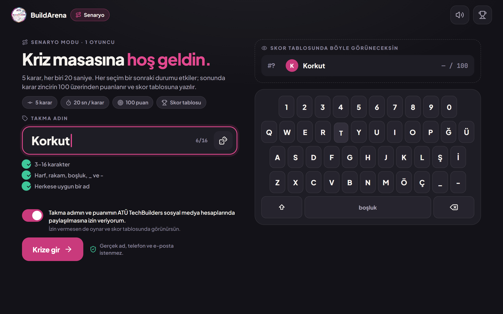

_Figure 2 — Nickname: live rules, consent switch and in-app Turkish keyboard._

- In-app Turkish Q keyboard, so the tablet's own keyboard doesn't cover half of the screen. It has
  Ğ, Ü, Ş, İ, Ö, Ç; capitals at the start of a word, ⇧ for one capital. Keys sink and ripple when
  pressed. _(The shipped game uses the tablet's keyboard; the stage lifts only when the field would
  be covered.)_
- Live rules: 3–16 characters · letters, digits, space, \_ and - · clean language. Each rule turns
  green ✓ or red ✕ while typing. For an unsuitable name: "This name can't be used, try another one."
- Same name: if the name was used today a number is added and shown in advance: "This name is taken
  today → it will be saved as Korkut_2."
- Dice button: writes a random tech + animal name for inspiration (e.g. "Cache Kedisi", "Async
  Ahtapot").
- Preview: top right, "this is how you will appear on the leaderboard".
- Consent (on by default, can be changed): "I agree that my nickname and score may be shared on ATÜ
  TechBuilders' social media accounts." Players who don't agree still play and appear on the board.
- Ambient animation: a small butterfly (the mode's mascot) glides across the background now and then.

### 3.2 Crisis wheel

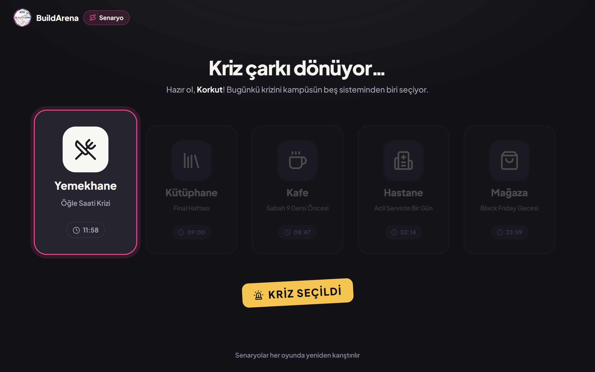

_Figure 3 — Crisis wheel: the highlight slows down from card to card and stops on a crisis._

- The scenario cards side by side; the highlight frame jumps to the next one with a "tick" and slows
  down (about 3 full rounds).
- The card it stops on grows and wobbles, the others dim; a "CRISIS SELECTED" stamp lands. After
  1.5 s the crisis intro opens.
- The scenario last played on the device is never picked, so consecutive players see different
  crises.

### 3.3 Crisis intro

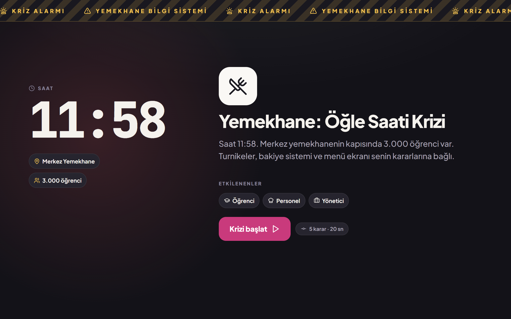

_Figure 4 — Crisis intro: scrolling warning tape, large clock, place and scale, crisis text._

- Crisis alarm: a yellow-and-black scrolling warning tape on top, "CRISIS ALARM · CAFETERIA
  INFORMATION SYSTEM", and a slowly pulsing red light behind. A short siren plays when it opens.
- A large clock (the colon blinks), place and scale chips (e.g. "3,000 students") and chips for the
  affected audience.
- The crisis text is typed out. "Start the crisis" → full-screen 3 · 2 · 1 · Go! countdown.

### 3.4 Decision step


_Figure 5 — Decision step: decision chain, situation card and 2×2 options._

| Area           | Content                                                                                                                                                                             |
| -------------- | ----------------------------------------------------------------------------------------------------------------------------------------------------------------------------------- |
| Top bar        | Logo · "SCENARIO" + scenario name · step 2/5 · 20 s timer ring · nickname chip · sound button                                                                                       |
| Decision chain | 5 nodes. A finished node carries the chosen option's icon (no colour, so right/wrong stays hidden); the current node pulses with a pink ring; the topics of later steps are hidden. |
| Situation card | "SITUATION · STEP 2 · DETAIL" label, the situation text (typed out) and the question in bold (slides in)                                                                            |
| Options        | 2×2 large cards: letter (A–D), icon, at most 6 words. The cards slide up one after another.                                                                                         |
| Hint           | "Tap an option · if time runs out this step scores 0"                                                                                                                               |

### 3.5 Butterfly effect

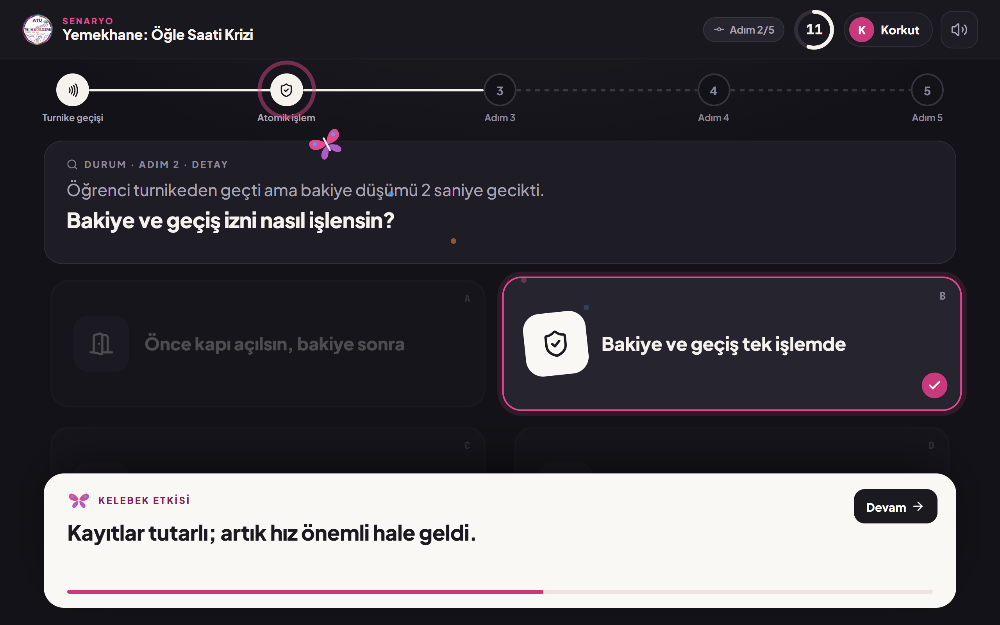

_Figure 6 — After a choice: the butterfly flies from the card to the chain, the effect card slides up._

- The chosen card grows, its icon turns on a light tile and gets a ✓ badge; the others dim.
- Flying butterfly: a butterfly in the logo's colours leaves the chosen card's icon and flaps along
  a curved path to the node in the chain, leaving a coloured trail. When it lands a ring wave spreads
  and the node fills with the chosen icon.
- Effect card: a cream card springs up from the bottom: "BUTTERFLY EFFECT · The records are
  consistent; now speed matters." A bar shows the time left; "Continue" or a tap on the card skips
  it.

### 3.6 Final: decision chain, score and title

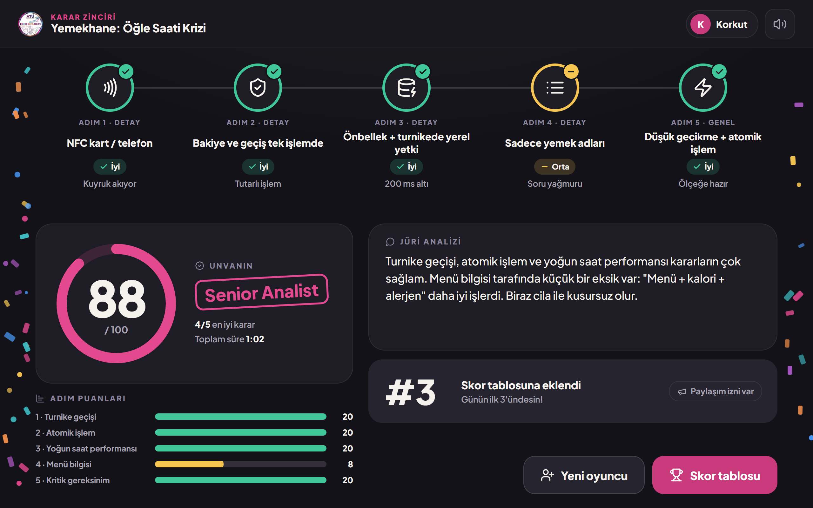

_Figure 7 — Final: the chain of 5 decisions, score ring, title stamp, jury analysis and leaderboard
rank._

- Decision chain: the line is drawn from left to right and the five nodes pop in one by one. Every
  node shows the chosen option's icon, its status (Good green ✓ · Average yellow – · Weak red ✕) and
  a one-line effect. Status is never shown by colour alone.
- Score ring: fills from 0 while the number counts up (e.g. 88/100).
- Title stamp: "Senior Analist" is stamped onto the screen (a low "thud").
- Step points: each step's points out of 20 as thin bars, with the values written next to them.
- Jury analysis, typed out. E.g.: "Your turnstile, atomic transaction and rush-hour decisions are
  very solid. The menu information is a little short: 'menu + calories + allergens' would have
  worked better."
- Rank animation: on the "Added to the leaderboard" card the rank counts up from the bottom to the
  real place (#11 → #3). Confetti at 75+, big confetti and a fanfare at 90+.

### 3.7 Leaderboard

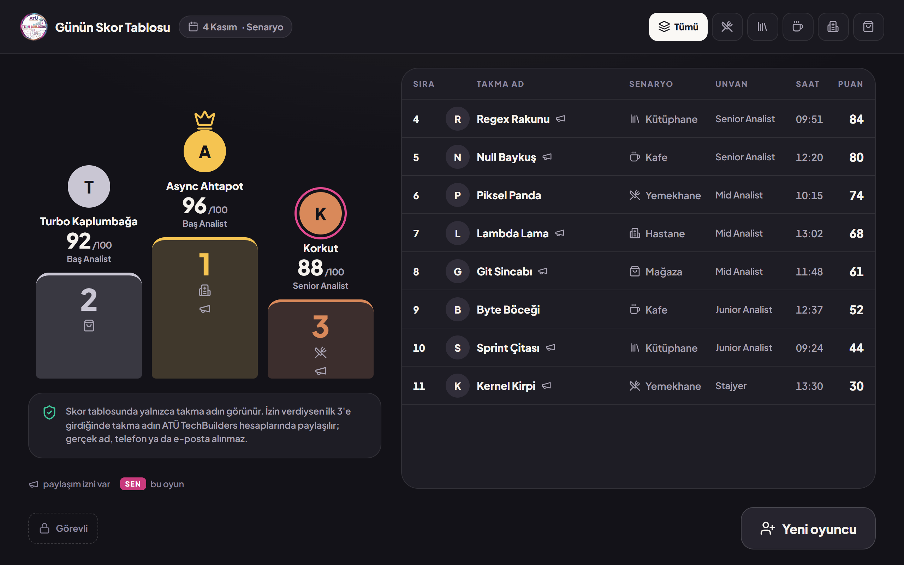

_Figure 8 — Today's leaderboard: podium, list, scenario filter and privacy (KVKK) note._

- Podium: the 2 · 1 · 3 columns rise from below; avatars and scores appear in turn, the crown drops
  onto 1st place. Gold, silver and bronze; the rank number is always written.
- List: from 4th place; rank, initial, nickname, scenario, title, time, score. Rows slide in from the
  right.
- "YOU" highlight: the row of the player who just played gets a pink stripe; in the top 3 their
  podium avatar gets a ring. Below 13th place it is added at the end after "• • •".
- A megaphone icon marks players who consented to sharing.
- Scenario filter: All + the scenario icons; the table animates again when the filter changes.
- Privacy (KVKK) note and the dashed Staff button bottom left (asks for the PIN).

### 3.8 Staff menu: export the top 3

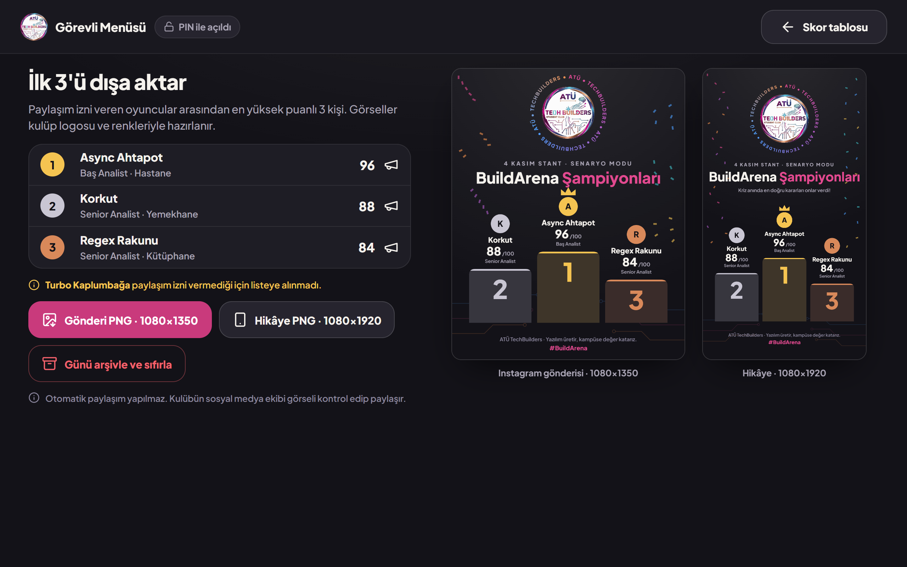

_Figure 9 — Staff menu: top 3 of those who consented, skipped players and image previews._

- Entry: the "Staff" button on the leaderboard or holding the logo for 3 s → 4-digit PIN (the dots
  shake on a wrong PIN).
- List: the 3 best scores among players who consented. Players skipped for lack of consent are named
  (e.g. "Turbo Kaplumbağa was left out because they didn't consent").
- Export: "Post PNG · 1080×1350" and "Story PNG · 1080×1920" download the image directly. Live
  previews on the right.
- Archive the day and reset: asks first; nothing is deleted, the records move to a dated archive.
- Nothing is posted automatically; the club's social media team checks the image and posts it.

### 3.9 Share images

| Instagram post · 1080 × 1350                | Story · 1080 × 1920                           |
| ------------------------------------------- | --------------------------------------------- |
| 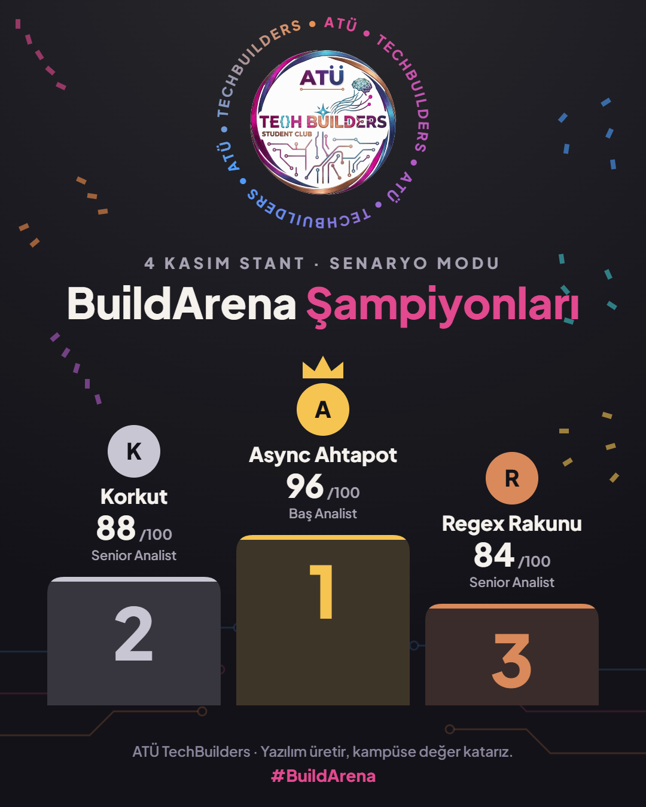 | 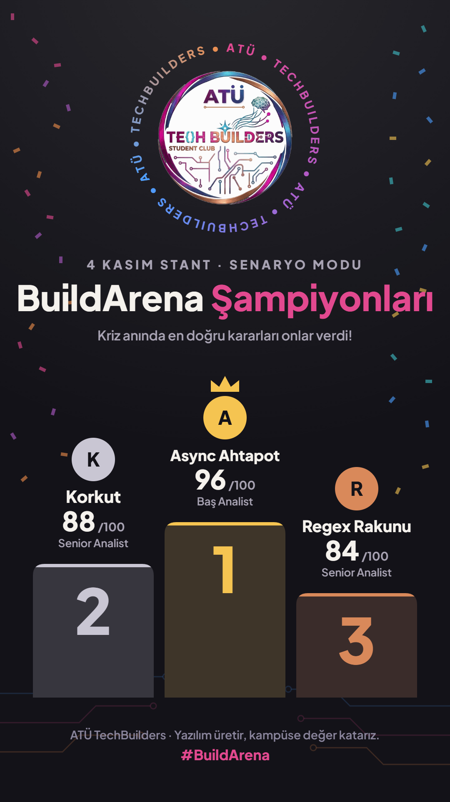 |

_Figure 10 — Share images made by the app (sample data)._

- The club logo, the still version of its turning ring text ("ATÜ • TECHBUILDERS"), "4 NOVEMBER
  BOOTH · SCENARIO MODE" and the title "BuildArena Champions".
- Podium: gold, silver and bronze columns; initial, nickname, score and title for every player, a
  crown on 1st place.
- Confetti in the logo's colours at the edges, a circuit-line ornament at the bottom; footer: "ATÜ
  TechBuilders · We build software and add value to the campus." and #BuildArena.
- The images are drawn entirely on the device (canvas); no internet needed.

## 4. Flow and timing

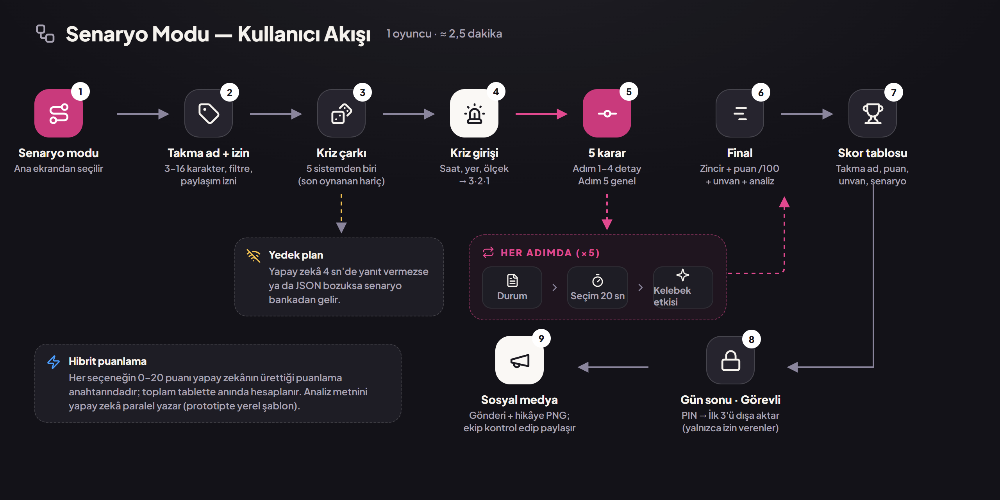

_Figure 11 — End-to-end flow of scenario mode._

1. Tap Scenario on the home screen.
2. Type a nickname, choose consent → "Enter the crisis".
3. The crisis wheel picks a scenario (generated by the AI, otherwise from the bank).
4. Read the crisis intro → "Start the crisis" → 3 · 2 · 1.
5. 5 decisions: situation → choice (20 s) → butterfly effect, at every step.
6. Final: chain, score, title, jury analysis; the record is written to the leaderboard.
7. Leaderboard → "New player" starts over.
8. At the end of the day the staff export the top 3 with the PIN; the team checks and posts them.

| Stage                                | Time (approx.)                           |
| ------------------------------------ | ---------------------------------------- |
| Nickname                             | 15–25 s                                  |
| Crisis wheel                         | 3 s + 1.5 s                              |
| Crisis intro + 3-2-1                 | 5–8 s                                    |
| 5 decisions (read + choose + effect) | 5 × (8–20 s + 2.6 s) ≈ 55 s – 1 min 55 s |
| Final animations                     | ≈ 6 s                                    |
| Total                                | ≈ 1.5 – 2.5 minutes                      |

## 5. Scenario bank (5 crises)

All five scenarios were written in full and put in `data/senaryolar.json` of the prototype. The same
content is the app's offline bank (`src/data/scenarios.json`, now with English keys and 16
scenarios). Every option's butterfly-effect text and the short summary shown in the final are in the
JSON; the tables below show the best option's effect for readability. The game content itself is
Turkish; the questions and options are translated here.

> **Validation of the bank (checked automatically).** Exactly 5 steps per scenario; steps 1–4
> detail, step 5 general · 4 options per step with exactly one 20-point option · option texts at
> most 6 words · all 88 icons exist in Lucide v0.460 · every scenario's maximum is 100. The
> cafeteria scenario's points were taken one-to-one from the club document (v1.2, section 7.4); two
> of its steps have no "reasonable" (10–14) option. The other four follow the rule exactly.

### 5.1 Cafeteria: lunch-hour crisis

System: Cafeteria Information System · Time: 11:58 · Place: Main cafeteria · Scale: 3,000 students ·
Affected: students, staff, managers

_"It is 11:58. 3,000 students are at the door of the main cafeteria. The turnstiles, the balance
system and the menu screen depend on your decisions."_

| Step        | Situation and question                                                                                                                 | Options (points)                                                                                                                                                             | Effect of the best option                            |
| ----------- | -------------------------------------------------------------------------------------------------------------------------------------- | ---------------------------------------------------------------------------------------------------------------------------------------------------------------------------- | ---------------------------------------------------- |
| 1 · Detail  | The queue at the door is growing. The entry method will decide the lunch hour. / How should students pass the turnstile?               | A · NFC card / phone (20) / B · QR code (14) / C · Staff enters the ID number (4) / D · Face recognition (6)                                                                 | The queue flows; passing takes 1 second.             |
| 2 · Detail  | A student passed the turnstile but the balance was charged 2 seconds later. / How should the balance and the entry be processed?       | A · Open the gate first, charge later (6) / B · Balance and entry in one transaction (20) / C · Charge everything at the end of the day (3) / D · Drop the balance check (0) | The records are consistent; now speed matters.       |
| 3 · Detail  | 12:00: 3,000 students arrived at once and the system slowed down. / How do you handle the load?                                        | A · One stronger server (10) / B · Leave the turnstiles open (2) / C · Cache + local authorisation at the turnstile (20) / D · Make the lunch break longer (5)               | Latency dropped below 200 ms.                        |
| 4 · Detail  | Students stop in front of the menu screen; the queue slows down again. / What should the menu screen show?                             | A · Dish names only (8) / B · Photos of the dishes (12) / C · Prices only (4) / D · Menu + calories + allergens (20)                                                         | A gluten-sensitive student chose correctly.          |
| 5 · General | The day is over. The rectorate wants the system on the whole campus. / What is this system's most critical non-functional requirement? | A · Low latency + atomic transactions (20) / B · Multi-language support (8) / C · A colourful, modern interface (4) / D · Social media integration (0)                       | Tomorrow 3,000 people will pass without trouble too. |

### 5.2 Library: finals week

System: Library Automation System · Time: 09:00 · Place: Main library · Scale: 1,200 students ·
Affected: students, academics, librarians

_"Finals week has started. There is a long queue in front of the library and everybody wants the
same three textbooks."_

| Step        | Situation and question                                                                                                                       | Options (points)                                                                                                                        | Effect of the best option                                    |
| ----------- | -------------------------------------------------------------------------------------------------------------------------------------------- | --------------------------------------------------------------------------------------------------------------------------------------- | ------------------------------------------------------------ |
| 1 · Detail  | A student looks for "Data Structures"; 40 results have the same title. / How should catalogue search work?                                   | A · By title only (10) / B · Filters for ISBN, author, category (20) / C · Ask the librarian (4) / D · Walk the shelves (0)             | The right edition was found in 5 seconds.                    |
| 2 · Detail  | Two students pressed "Reserve" for the last copy in the same second. / What happens when one book gets two reservations?                     | A · Confirm both (0) / B · The librarian picks one (6) / C · Lock: first come, first served (20) / D · Waiting list without a lock (12) | One got the book, the other was told "you are 1st in line".  |
| 3 · Detail  | Finals are over but 120 books haven't been returned. / How should overdue books be followed up?                                              | A · Automatic fine + reminder (20) / B · Daily fine only (12) / C · One warning at the end of term (5) / D · No follow-up (0)           | 80 % were returned within 3 days.                            |
| 4 · Detail  | The system shows 3 copies but there is only one on the shelf. / How should copies and stock be tracked?                                      | A · One count per term (10) / B · A total in a spreadsheet (6) / C · Book titles only (2) / D · Barcode + status per copy (20)          | The missing copy was found in 2 minutes: on the wrong shelf. |
| 5 · General | The rectorate wants the system on 5 campuses; 2,000 people will connect at the same time. / What is this system's most critical requirement? | A · Personal book suggestions (10) / B · Concurrency control (20) / C · Dark mode (4) / D · Social media sharing (0)                    | 5 campuses, 2,000 people, not one double reservation.        |

### 5.3 Café: before the 9 o'clock class

System: Café Automation and Ordering System · Time: 08:47 · Place: Campus café · Scale: 200 students,
2 baristas · Affected: customers, baristas, cashier

_"The 9 o'clock class starts in 13 minutes. 200 students and only 2 baristas are in the café; the
queue reaches the door."_

| Step        | Situation and question                                                                                                | Options (points)                                                                                                                               | Effect of the best option                                         |
| ----------- | --------------------------------------------------------------------------------------------------------------------- | ---------------------------------------------------------------------------------------------------------------------------------------------- | ----------------------------------------------------------------- |
| 1 · Detail  | The queue at the till reaches the door; everybody is trying to make it to class. / How should orders be taken?        | A · One till, one by one (6) / B · Open a second till (12) / C · The barista memorises them (0) / D · QR menu at the table (20)                | The queue is gone; orders flow in from the tables.                |
| 2 · Detail  | Orders are coming in but the barista mixes up the paper slips. / How should an order reach the barista?               | A · Real-time kitchen display (20) / B · Printed slip (12) / C · A waiter calls it out (4) / D · A message group (2)                           | Orders are on the screen in order; a ready one closes with a tap. |
| 3 · Detail  | 140 lattes were sold today; the milk ran out at noon. / How should stock be tracked?                                  | A · Manual count at the end of the day (10) / B · The barista's guess (3) / C · Automatic deduction by recipe (20) / D · No stock tracking (0) | When milk fell to 20 % the supplier was alerted.                  |
| 4 · Detail  | 08:55: the café's internet went down. / What should the system do without internet?                                   | A · Show an error screen (2) / B · Work locally, sync later (20) / C · Take cash, write it down (10) / D · Close the café (0)                  | Nobody noticed; everything synced when the connection came back.  |
| 5 · General | The café chain wants the system in its 6 branches on campus. / Which non-functional requirement is the most critical? | A · Loyalty points (6) / B · Fast response time (14) / C · Animated menu (2) / D · Working offline (20)                                        | Even without internet the coffee keeps flowing in 6 branches.     |

### 5.4 Hospital: a day in the emergency room

System: Hospital Information Management System · Time: 02:14 · Place: Emergency room · Scale: 40
patients, 6 doctors · Affected: patients, doctors, nurses

_"It is 02:14. A busy night shift in the emergency room: 40 patients, 6 doctors and a newly
installed hospital system."_

| Step        | Situation and question                                                                                                                       | Options (points)                                                                                                                                                       | Effect of the best option                                         |
| ----------- | -------------------------------------------------------------------------------------------------------------------------------------------- | ---------------------------------------------------------------------------------------------------------------------------------------------------------------------- | ----------------------------------------------------------------- |
| 1 · Detail  | 30 appointments in the morning clinic were cancelled but the free slots appear on nobody's screen. / What happens to cancelled appointments? | A · Reopen them by hand at the end of the day (10) / B · Call people one by one (6) / C · Offer them to the waiting list automatically (20) / D · Leave them empty (2) | The free slots filled in 10 minutes; those waiting got an SMS.    |
| 2 · Detail  | An unconscious patient was brought in; they are allergic to penicillin but nobody knows. / Where should the allergy information live?        | A · In the electronic record, with a warning (20) / B · On a health card in the wallet (10) / C · In a paper file (4) / D · In the doctor's memory (0)                 | A red warning appeared while prescribing; the danger was avoided. |
| 3 · Detail  | A blood test came back at 03:00; the potassium value is critical. / How should the result reach the doctor?                                  | A · It waits on the lab screen (8) / B · A nurse phones it in (12) / C · With the morning report (2) / D · Instant alert for critical values (20)                      | The doctor stepped in within 2 minutes.                           |
| 4 · Detail  | An intern, a nurse, a doctor and the cashier all want to see the same record. / Who sees which data?                                         | A · Everybody sees everything (0) / B · Role-based access (RBAC) (20) / C · Full for the doctor, a summary for the rest (12) / D · One shared password (3)             | The cashier sees the bill, the doctor the full history.           |
| 5 · General | The ministry's audit is at the door; the system will spread to every hospital. / What is the most critical non-functional requirement?       | A · Screens that open fast (12) / B · A mobile app theme (4) / C · Social media sharing (0) / D · Encryption + KVKK + audit trail (20)                                 | Full marks in the audit: every access logged, data encrypted.     |

### 5.5 Store: Black Friday night

System: Store / E-commerce App · Time: 23:59 · Place: Online store · Scale: 50,000 visitors · Affected:
customers, managers, shipping

_"It is 23:59. Black Friday is about to start; 50,000 people on the site are waiting for the
discounts to open."_

| Step        | Situation and question                                                                                                             | Options (points)                                                                                                                                                                   | Effect of the best option                                    |
| ----------- | ---------------------------------------------------------------------------------------------------------------------------------- | ---------------------------------------------------------------------------------------------------------------------------------------------------------------------------------- | ------------------------------------------------------------ |
| 1 · Detail  | There are 12,000 products; a customer looks for "a black coat, size M, under 500 TL". / How should products be found?              | A · Combined filters: size, colour, price (20) / B · Category menu only (10) / C · One long list on the home page (2) / D · Ask customer service (4)                               | The coat is in the cart in 3 taps.                           |
| 2 · Detail  | The customer entered the code "BF50"; the discount and the shipping fee clash. / What should the cart show?                        | A · The code only on the first order (6) / B · Shipping fee later by e-mail (3) / C · Discount in the cart, shipping at payment (12) / D · Code + shipping calculated at once (20) | The total is clear from the start; nobody abandons the cart. |
| 3 · Detail  | The order is placed; the customer writes "where is my parcel?" for the 3rd time. / How should the order status be shown?           | A · Only a "shipped" e-mail (10) / B · Live step-by-step tracking (20) / C · The customer calls and asks (2) / D · Delivery is a surprise (0)                                      | Preparing → shipped → out for delivery; questions halved.    |
| 4 · Detail  | The coat is too small; the customer wants to return it. / How should returns work?                                                 | A · Request by e-mail, wait 7 days (4) / B · Bring it back to a store (10) / C · Return code in the app + courier (20) / D · No returns (0)                                        | A return code in 2 minutes; the customer shopped again.      |
| 5 · General | At 00:00 traffic grew 50-fold; last year the site was down for 12 minutes. / What is the most critical non-functional requirement? | A · Night maintenance mode (4) / B · Animated home page (2) / C · One stronger server (10) / D · Horizontal scaling + cache (20)                                                   | 50,000 people at once; the site opens in a second.           |

## 6. Scoring and titles

### 6.1 Score

- 5 steps × 20 points = 100. Every option's 0–20 points are in the scoring key the AI produced with
  the scenario; they are never shown to the player during the game.
- A step whose time runs out scores 0.
- Ranking: score (high to low) → on a tie, total decision time (shorter first) → on a tie, the
  earlier game first.

> **Shipped game:** the scoring was redesigned with the club — difficulty weights per step shared out
> to exactly 100, a convex accuracy curve and a 10 % speed share. See `src/game/scoring.ts` and the
> README.

### 6.2 Titles

| Score  | Title (shown in Turkish)                             |
| ------ | ---------------------------------------------------- |
| 90–100 | Baş Analist (Lead Analyst)                           |
| 75–89  | Senior Analist                                       |
| 55–74  | Mid Analist                                          |
| 35–54  | Junior Analist                                       |
| 0–34   | Stajyer (ama umut var!) — Intern (but there's hope!) |

### 6.3 Status labels in the final

| Step points | Status  | Shown as                             |
| ----------- | ------- | ------------------------------------ |
| 16–20       | Good    | Green ring + ✓ badge + "İyi" label   |
| 8–15        | Average | Yellow ring + – badge + "Orta" label |
| 0–7         | Weak    | Red ring + ✕ badge + "Zayıf" label   |

### 6.4 Worked example

| Step                     | Choice                                       | Points |
| ------------------------ | -------------------------------------------- | ------ |
| 1 · Turnstile entry      | NFC card / phone                             | 20     |
| 2 · Atomic transaction   | Balance and entry in one transaction         | 20     |
| 3 · Rush hour            | Cache + local authorisation at the turnstile | 20     |
| 4 · Menu information     | Dish names only                              | 8      |
| 5 · Critical requirement | Low latency + atomic transactions            | 20     |
| Total                    | 88 / 100 → Senior Analist                    | 88     |

### 6.5 "The AI gives the score": the hybrid method

**Recommended: hybrid (same as project document v1.2).** While generating the scenario the AI also
sets every option's points. When the game ends the total is computed instantly on the tablet; the
AI writes the jury analysis in parallel. Why? The result comes without waiting · the same choices
always get the same score (fair, indisputable) · it keeps working when the internet drops. A full AI
scoring mode could be switched on in the settings: the choices are sent to the model and the model
gives the score; even then it is compared with the local result, and when they differ by more than
15 points the local score is shown (a consistency guard).

> **Shipped game:** the club decided against any API (2026-10-25). The scenarios come from the
> local bank and the jury analysis from a local template (`src/ai/juryAnalysis.ts`).

## 7. Nickname rules and privacy (KVKK)

| Rule               | Detail                                                                                                                                                                                                   |
| ------------------ | -------------------------------------------------------------------------------------------------------------------------------------------------------------------------------------------------------- |
| Length             | 3–16 characters (leading and trailing spaces don't count)                                                                                                                                                |
| Characters         | Letters (Turkish included), digits, space, \_ and -                                                                                                                                                      |
| Clean language     | A local word list (Turkish + English; spellings with digits such as "s1k" are caught too) + an AI check. For an unsuitable name: "This name can't be used, try another one."                             |
| Same name          | If the name was used today a number is added (Korkut → Korkut_2); the player sees it in advance                                                                                                          |
| Consent            | A switch under the name field: "I agree that my nickname and score may be shared on ATÜ TechBuilders' social media accounts." Without consent the player still appears on the board but is never shared. |
| Never asked        | Real name, student number, e-mail, phone or photo are neither asked for nor stored                                                                                                                       |
| Staff intervention | An unsuitable record can be hidden from the board (staff menu)                                                                                                                                           |

**Notice shown at the booth.** "Only your nickname appears on the leaderboard. If you agree and reach
the top 3, your nickname is shared on our club's accounts. We don't take your real name, phone or
e-mail." If there is a prize, winners introduce themselves at the booth with their nickname; no
contact details are kept in the app.

> **Shipped game:** the AI check was dropped; the local filter was made much stricter instead
> (`src/game/profanity.ts`, `src/data/badwords.json`), see the README.

## 8. Leaderboard and sharing the top 3

| Item    | Description                                                                                                                     |
| ------- | ------------------------------------------------------------------------------------------------------------------------------- |
| Scope   | Every scenario game is saved. (Duel results optionally in a separate "Today's duels" list.)                                     |
| Columns | Rank · nickname · scenario · title · time · score (+ consent icon)                                                              |
| Ranking | Score ↓ → on a tie total time ↑ → on a tie the earlier game first                                                               |
| Views   | Podium (top 3) + list (4–13) + "YOU" row; scenario filter; trophy icon on the home screen; "Today's top 3" turning in idle mode |
| Storage | IndexedDB (Dexie) in the app: kept when the tablet is switched off. The prototype uses the browser's localStorage.              |
| Reset   | Daily reset from the staff menu (PIN); old records are never deleted, they move to a dated archive                              |

### 8.1 Today's top 3

1. At the end of the event the staff open the "Export the top 3" screen with the PIN.
2. The app takes the 3 best scores among players who consented and names the ones skipped for lack
   of consent.
3. A 1080×1350 Instagram post and a 1080×1920 story image (PNG) are drawn with the club's logo and
   colours.
4. The club's social media team checks the image and posts it. Nothing is posted automatically.

## 9. AI (NVIDIA API catalogue) — cancelled

_The club later decided against any API; this section is kept for the record._ The decision in project
document v1.2 stood: an OpenAI-compatible NVIDIA endpoint, the key only on a proxy server, a 4 s
timeout and an offline fallback. The model had not been chosen.

| Task                | When                | Endpoint      | Output                                                       |
| ------------------- | ------------------- | ------------- | ------------------------------------------------------------ |
| Scenario generation | Start of a scenario | /api/scenario | 5-step scenario JSON + scoring key + effect texts            |
| Jury analysis       | Final               | /api/comment  | At most 3 sentences: strong decisions + weakest step + close |
| Nickname check      | Nickname entry      | /api/nickname | `{ "clean": true/false }`                                    |

### 9.1 Scenario JSON schema

Shown with the English keys the app uses today (`src/ai/schemas.ts`); the texts are Turkish game
content.

```json
{
  "id": "cafeteria",
  "title": "Yemekhane: Öğle Saati Krizi",
  "system": "Yemekhane Bilgi Sistemi",
  "icon": "utensils-crossed",
  "time": "11:58",
  "place": "Merkez Yemekhane",
  "scale": "3.000 öğrenci",
  "intro": "Saat 11:58. Merkez yemekhanenin kapısında 3.000 öğrenci var. ...",
  "audience": [{ "name": "Öğrenci", "icon": "graduation-cap" }],
  "steps": [
    {
      "no": 1,
      "level": "detail",
      "topic": "turnike geçişi",
      "situation": "Kapıda kuyruk büyüyor. ...",
      "question": "Öğrenciler turnikeden nasıl geçsin?",
      "options": [
        {
          "id": "a",
          "text": "NFC kart / telefon",
          "icon": "nfc",
          "points": 20,
          "effect": "Kuyruk akıyor; geçiş 1 saniye sürüyor.",
          "summary": "Kuyruk akıyor"
        }
      ]
    }
  ]
}
```

Three fields were added to the project document's schema: `topic` (analysis and chain label),
`summary` (the short effect under a node in the final) and `time` / `place` / `scale` / `intro` for
the crisis intro. Validation rules: exactly 5 steps · steps 1–4 `detail`, step 5 `general` · 4 options
per step · exactly one 20-point option per step · one option 10–14 · two options 0–8 · option text ≤ 6
words · icon from the allow-list. A response that fails validation is discarded and a scenario comes
from the bank.

### 9.2 Prompts (draft)

**Scenario generation.** You design a software-requirements scenario game. Write in Turkish.
System: {system}. Source requirements: {requirement_summary}. Generate a 5-step single-player decision
scenario that opens with a moment of crisis: write a time, a place, a scale and a 2-sentence intro.
Steps 1–4 ask concrete, detailed requirement decisions (which entry method, which data to show, what
to do in an error or a rush). Step 5 asks a general decision about the whole system (the most
critical non-functional requirement). Every step has 4 options: 1 best (20), 1 reasonable (10–14),
2 weak (0–8); the best one is not always in the same place. For every option write a one-sentence
"effect" (describe the outcome, never say right or wrong) and a 2–3 word "summary". Option text at most
6 words. Pick icons only from the given Lucide list. Return ONLY JSON matching the given schema.

**Jury analysis (final).** You are the friendly, witty jury of a scenario game. Write in Turkish.
Input: the scenario title, the topics of the 5 steps, the player's choices and each step's points
(0–20), the total. Write at most 3 sentences: (1) praise the 20-point decisions by name, (2) gently say
which option would have been better at the lowest step, (3) a short closing sentence that fits the
score. Judge the decisions, not the person; no swearing, insults, looks, religion or politics. Return
only JSON: `{"analysis": "..."}`

**Nickname check.** You check nicknames at a university booth game. Name: "{name}". It is unsuitable if
it contains swearing, insults, sexual content, hate speech, a real person's name or a brand. Count
spellings with swapped letters (s1k, @ …) too. Return only JSON: `{"clean": true}`

### 9.3 Fallback plan

- Before the booth 15–20 scenarios are generated and read by the club; the 5 scenarios in this
  document are the core of the bank.
- If a response takes longer than 4 s or fails validation, the scenario comes from the bank; the
  player doesn't notice.
- Without a jury analysis a local template is used (it works in the prototype): strong decisions +
  the right move at the weakest step + a close that fits the score.
- Without a nickname check only the local word list applies.

## 10. Animation and effect catalogue

The animations follow the v0.2 rules: no glow and no neon; motion, scale, springs and coloured
particles. Confetti and butterfly colours come from the logo. Sounds need no files; they are made with
Web Audio and switched off with one button.

| Screen           | Animation                                                                                                                                                                                                | Duration                  | Sound                                 |
| ---------------- | -------------------------------------------------------------------------------------------------------------------------------------------------------------------------------------------------------- | ------------------------- | ------------------------------------- |
| Nickname         | Key press + ripple · rule badges spring to ✓ · the field shakes on bad input · the dice spins and the name is typed letter by letter · the consent switch springs · a butterfly glides in the background | 0.1–0.6 s · butterfly 9 s | key click                             |
| Crisis wheel     | The highlight jumps from card to card, cubic slow-down · the winning card grows + wobbles, the others dim · "CRISIS SELECTED" stamp                                                                      | ≈ 3 s + 0.55 s            | tick · stamp                          |
| Crisis intro     | Scrolling yellow-and-black tape · scrolling text · pulsing red light · blinking clock · typed text · 3-2-1 shrinking from large                                                                          | continuous · 3-2-1 ≈ 3 s  | siren · tick                          |
| Decision step    | Situation typed · question slides in · options rise one by one · the current node pulses · the timer ring empties, red + pulse in the last 5 s                                                           | 0.4 s + 80 ms apart       | tick-tock in the last 5 s             |
| Choice           | The chosen card grows, the icon turns, the ✓ badge springs · the others dim                                                                                                                              | 0.4 s                     | two-tone "ding"                       |
| Butterfly effect | The butterfly flaps along a curve + coloured trail · ring wave at the node · node pop · the chain line fills · the cream card springs up + progress bar                                                  | 1 s + 0.55 s · card 2.6 s | wing flutter                          |
| Final            | The chain line is drawn left to right · 5 nodes pop in turn · step bars fill · score ring + counter · title stamp · analysis typed · rank counter counts up                                              | ≈ 6 s                     | rising notes · "thud" · fanfare (75+) |
| Final confetti   | 60 pieces at 75+, 120 at 90+, in the logo's colours                                                                                                                                                      | 2.2–3.6 s                 | fanfare                               |
| Leaderboard      | Podium columns rise · avatars pop · the crown drops and bounces · list rows slide in from the right · animates again on a filter change                                                                  | 0.7 s + delays            | ding                                  |
| Staff            | PIN dots fill · they shake on a wrong PIN · a toast springs up                                                                                                                                           | 0.35–0.45 s               | click · warning                       |
| Transitions      | Soft slide + fade between screens                                                                                                                                                                        | 0.45 s                    | —                                     |

Accessibility: with "reduce motion" on the device, animations jump to their last frame and the
butterfly doesn't fly. The sound button is at the top right of every screen.

## 11. Design: scenario components

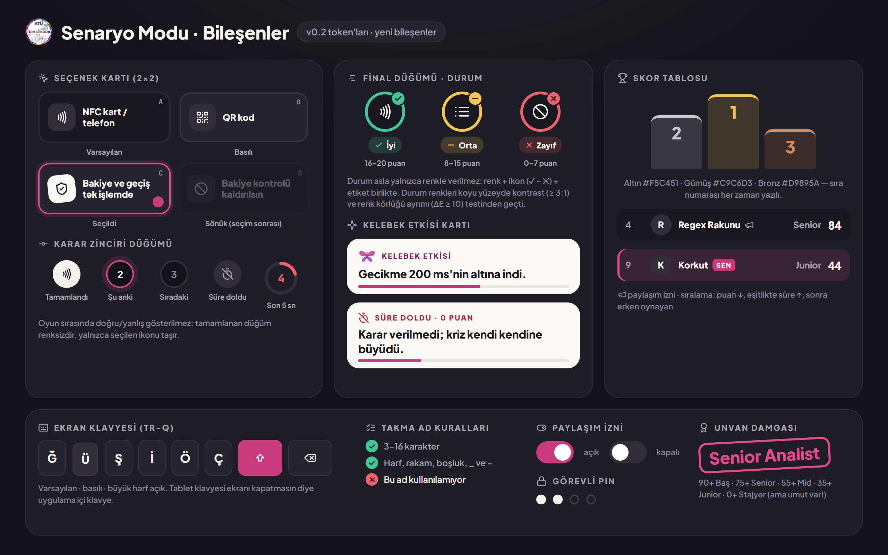

_Figure 12 — The new scenario components and their states (v0.2 tokens)._

- Same design system: project 1's v0.2 tokens (`design-source/base.css`) as they are — calm graphite
  background, logo-pink brand, cream "paper" cards, Plus Jakarta Sans + JetBrains Mono, Lucide icons.
  _(The shipped game uses the later "Renk Paleti", see `docs/palette/`.)_
- The status colours were validated with the dataviz skill's palette checker (#3FC79A · #F5C451 ·
  #F2616B on the dark surface #1E1D25): contrast ≥ 3:1; the weakest pair under colour blindness ΔE 10.3
  (target ≥ 8), ΔE 20.4 with normal vision. Status is still always shown with an icon and a label.
- Score ring: brand-pink fill, the empty track a light tint of the same colour; the big score in the
  same typeface as the rest of the screen (Plus Jakarta Sans), the one "hero" number.
- Podium colours (gold #F5C451, silver #C9C6D3, bronze #D9895A) are used only for ranks; the rank
  number is always written.
- The butterfly is the mode's mascot: logo-pink upper wings, purple lower wings, blue spots.

## 12. Playable prototype

`prototype/index.html` opens in a browser with a double click and plays from start to finish. No
installation; the internet is used only for fonts (otherwise it falls back to system fonts). The
prototype's own code and texts are Turkish, as the club delivered it.

| Feature            | How                                                                                                                         |
| ------------------ | --------------------------------------------------------------------------------------------------------------------------- |
| Play               | Nickname → Enter the crisis → wheel → Start the crisis → 5 decisions → final → leaderboard                                  |
| Keyboard shortcuts | Options: A–D or 1–4 · skip the effect card: Enter / space · nickname: a physical keyboard works too                         |
| Staff              | Leaderboard → "Görevli" or hold the logo for 3 s · prototype PIN: 1234                                                      |
| Demo mode          | `index.html?oto` — the game plays itself (usable as an idle screen at the booth); these games are not saved                 |
| Short timer        | `index.html?sure=8` — changes the step time (for testing)                                                                   |
| Screenshot mode    | `index.html?ekran=nick \| wheel \| intro \| step \| effect \| final \| board \| admin \| post \| story`                     |
| Data               | Scores are kept in the browser; 10 sample records on first open. "Archive the day and reset" in the staff menu clears them. |

### 12.1 Test result

The prototype was played end to end with real clicks in Puppeteer: typing a name on the on-screen
keyboard, all 5 steps, the final, the leaderboard, the scenario filter, wrong and right PIN, the staff
screen; the time-out path, the profanity filter and the same-name suffix separately. No console
errors; score, title, rank and record correct.

### 12.2 Limits of the prototype

- No AI calls: scenarios come from the bank, the jury analysis from a local template (the same as the
  app's fallback).
- The word list is a short sample.
- Scores live in localStorage; the app should use IndexedDB (Dexie) and an optional cloud sync.
- The prototype is a single file of vanilla JS; when porting to React the logic and styles can be
  split straight into components (section 13).

## 13. Development notes

| Prototype part            | React component (project document 13.3)                                   | Work package  |
| ------------------------- | ------------------------------------------------------------------------- | ------------- |
| Nickname + keyboard       | ScenarioNickname + OnScreenKeyboard                                       | WP-10         |
| Crisis wheel + intro      | ScenarioIntro (CrisisWheel, Countdown)                                    | WP-10 · WP-16 |
| Decision step + butterfly | ScenarioGame (ChainView, OptionCard, EffectSheet, Butterfly)              | WP-10 · WP-16 |
| Final                     | ScenarioResult (ScoreRing, StepBars, TitleStamp)                          | WP-10         |
| Leaderboard               | Leaderboard (Podium, LeaderRow)                                           | WP-13         |
| Staff + sharing           | Admin (PinPad, ShareImage → canvas or html-to-image)                      | WP-13 · WP-15 |
| Score and analysis        | `game/scoring.ts` (scenario: 5 × 20) + `ai/` (fallback analysis template) | WP-08 · WP-12 |
| Scenario bank             | `data/senaryolar.json` → `src/data/scenarios.json` + Zod schema           | WP-03         |

### 13.1 Claude Code starter prompt (scenario mode)

> Add the scenario mode to the BuildArena project. First read the project document (sections 7, 8,
> 11.2, 12.5) and the scenario mode document. Reference: `prototype/index.html` (behaviour,
> animations, timings) and `design-source/base.css` (v0.2 tokens). Don't use neon, glow or "AI"
> ornaments. Screens: ScenarioNickname (in-app TR-Q keyboard, live rules, same-name suffix, consent),
> ScenarioIntro (crisis wheel + crisis intro + 3-2-1), ScenarioGame (chain, 20 s timer, 2×2 options,
> flying butterfly, effect card), ScenarioResult (chain, score ring, title stamp, analysis, rank),
> Leaderboard (podium + list + filter), Admin (PIN, export the top 3: 1080×1350 and 1080×1920 PNG).
> Scenarios in `src/data/scenarios.json`, validated with Zod. The score is a pure function in
> `game/scoring.ts`, tested with Vitest: the example in section 6.4 must give 88 points and "Senior
> Analist". Scores in Dexie (IndexedDB). Animations with Framer Motion; support
> `prefers-reduced-motion`. All UI texts in Turkish.

## 14. Open questions (at the time of writing)

| Question                                 | Our suggestion                                                                                                                                |
| ---------------------------------------- | --------------------------------------------------------------------------------------------------------------------------------------------- |
| How long should the butterfly card stay? | 2.6 s + tap to skip (section 2.2); compare with 1.5 s at the 2 November test                                                                  |
| Should consent be on by default?         | On in the prototype. Starting off is the more careful choice under KVKK; the club decides                                                     |
| May one person play more than once?      | Yes, every game is a separate record; whether the board shows a person's best score or every game is the club's call (suggestion: every game) |
| Will there be more than one tablet?      | If so, Supabase's free tier for a shared leaderboard (project document 13.2)                                                                  |
| Are there enough scenarios?              | 5 core + 15–20 AI variations; the club reads them before the booth                                                                            |
| Title and scenario on the share image?   | The title is there; the scenario name can be added (there is room)                                                                            |
| Prize?                                   | A small gift for the day's top 3; winners introduce themselves by nickname                                                                    |

### 14.1 Files in this folder

- `SCENARIO_MODE.md` — this document (English); `BuildArena_Scenario_Mode_TR.docx` / `.pdf` — the
  original Turkish document
- `prototype/` — the playable prototype (`index.html` + `senaryolar.js` + `logo-data.js` +
  `lucide.min.js`)
- `images/` — high-resolution PNGs of the document's 12 figures (the share images at real size)
- `design-source/` — HTML sources of the flow and component pages + `base.css`
